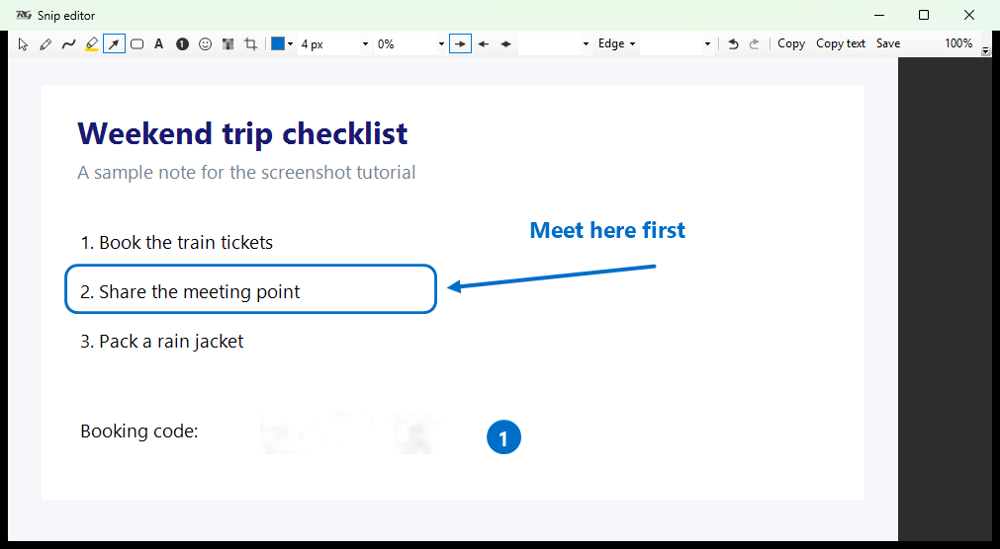
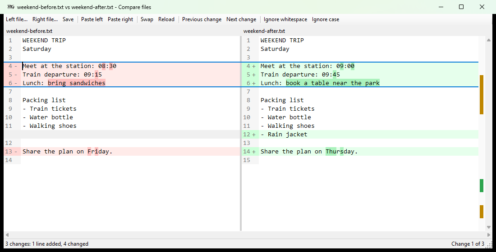
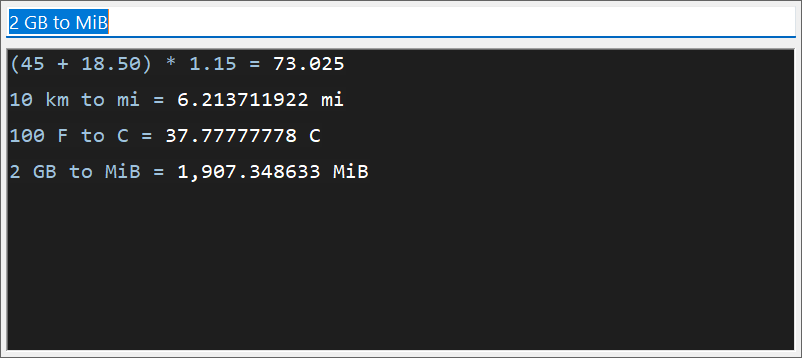
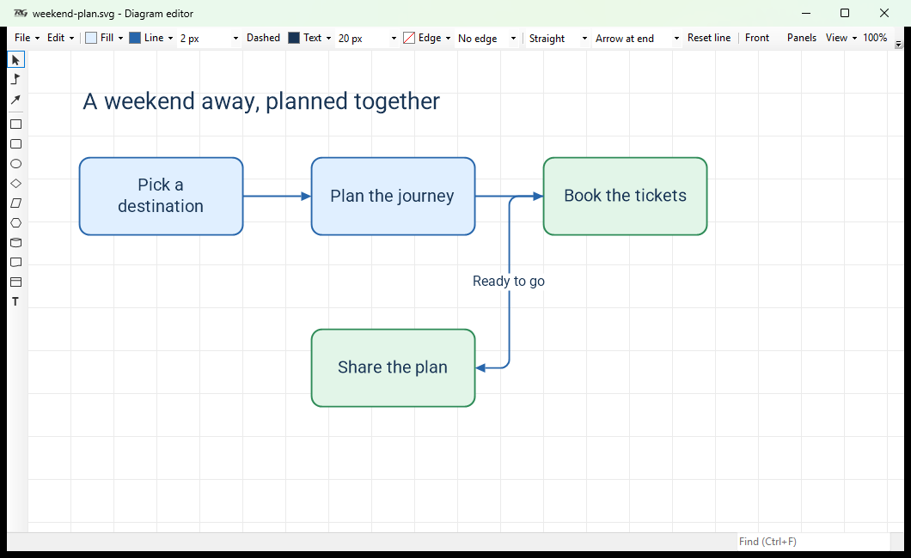
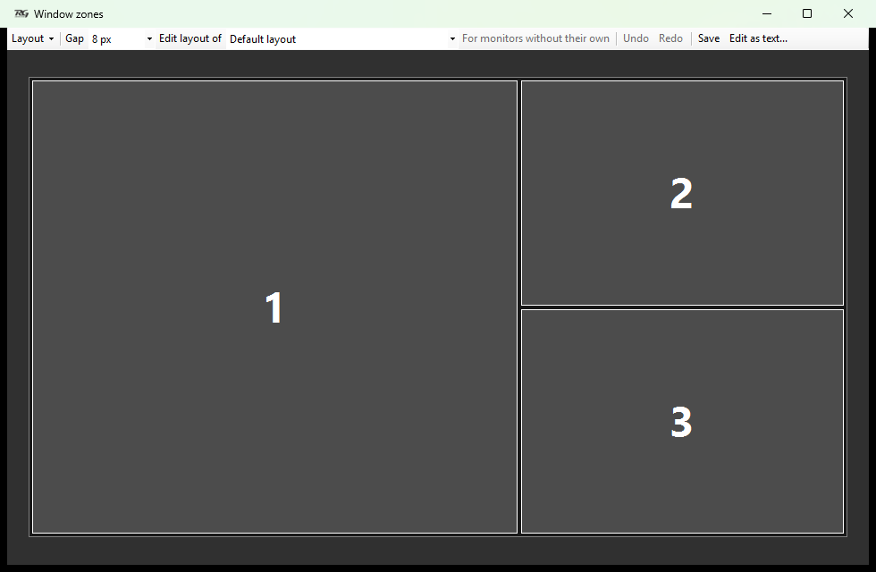
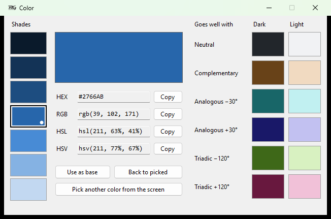
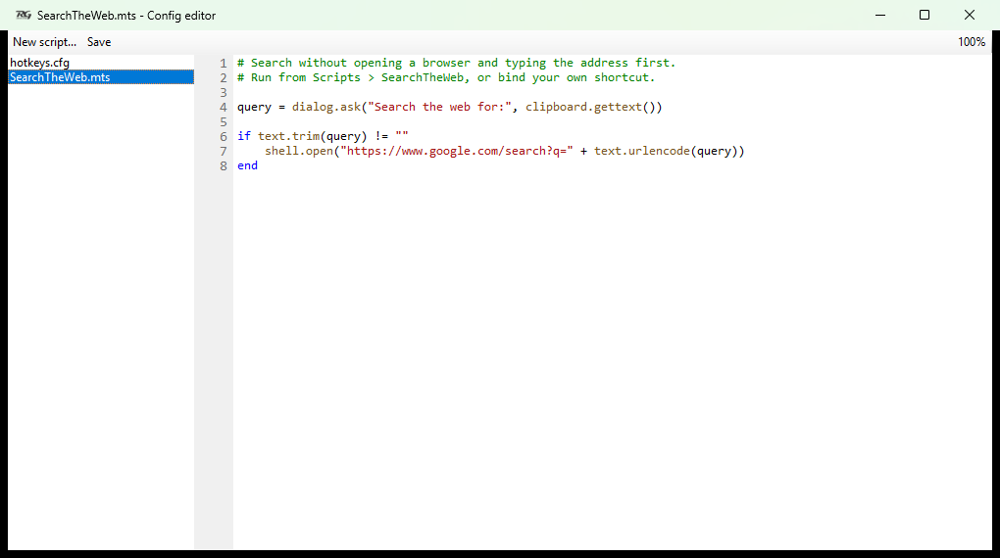

# MyTools

**Everyday Windows tools, one shortcut away.**

Capture a screenshot and explain it with arrows. Record a quick how-to. Find what changed between two documents.
Arrange your windows, convert a measurement, or turn a repeated task into a shortcut—all from your system tray.

**Free and open source. No installer.** Download the Windows ZIP, extract it, and run MyTools.

[**Download for Windows**](https://github.com/rickygzz/CincoVertice.MyTools/releases/latest) ·
[**Try the step-by-step tutorials**](docs/user-guide/16-tutorials.md) ·
[**See every feature**](#see-it-in-action) ·
[**Get help**](docs/user-guide/README.md)



*Make the useful part of a screenshot obvious. These screenshots show the real MyTools interface with sample data.*

## Your first two minutes

1. [Download the latest release](https://github.com/rickygzz/CincoVertice.MyTools/releases/latest) and extract the ZIP into a folder you can write to.
2. Run `CincoVertice.MyTools.Ui.Win.exe`. Look for **My Tools** in the Windows system tray; check the hidden icons arrow if needed.
3. Press **Ctrl+Alt+S**, drag over part of your screen, and add an arrow in the editor. **Ctrl+C** copies it; **Ctrl+S** saves it.
4. Press **Ctrl+Alt+C**, type `10 km to mi`, and press **Enter**.

You can also right-click the tray icon and choose a tool from **Actions**. If a shortcut is already taken by another
program, **Hotkey problems** in the tray menu tells you which one. [First-run help](docs/user-guide/01-getting-started.md).

The release is self-contained: you do not need to install .NET. Settings stay in a `config` folder next to the program.
Windows may ask you to confirm an unsigned application; see [Troubleshooting](docs/user-guide/11-troubleshooting.md).

## What would you like to do?

| Your task | MyTools can help | Start here |
|---|---|---|
| Explain something on your screen | Snip, draw arrows, add text and numbered steps, hide details, crop, and save | **Ctrl+Alt+S** · [Tutorial](docs/user-guide/16-tutorials.md#1-explain-a-screenshot) |
| Copy words you cannot select | Capture an area and recognize its text for the clipboard | **Ctrl+Alt+T** · [Tutorial](docs/user-guide/16-tutorials.md#2-copy-text-from-a-picture) |
| Show someone what to click | Record an area as MP4 or GIF, with optional click and shortcut overlays | **Ctrl+Alt+R** · [Tutorial](docs/user-guide/16-tutorials.md#3-record-a-short-how-to) |
| Find what changed | Compare and edit two text files or pasted texts side by side | Tray → **Compare files...** · [Tutorial](docs/user-guide/16-tutorials.md#4-find-what-changed-between-two-texts) |
| Work out a number or conversion | Calculate expressions; convert units, temperatures, time zones, and dates | **Ctrl+Alt+C** · [Tutorial](docs/user-guide/16-tutorials.md#7-calculate-and-convert-without-breaking-your-flow) |
| Put a plan into a picture | Draw shapes and connectors; save editable SVG and export PNG or PDF | **Ctrl+Alt+D** · [Tutorial](docs/user-guide/16-tutorials.md#5-draw-a-plan-you-can-share) |
| Keep your workspace organized | Design window zones and drop windows into them | **Shift while dragging a window** · [Tutorial](docs/user-guide/16-tutorials.md#6-set-up-a-workspace-that-fits-your-task) |
| Reuse a color you see | Pick a screen color, copy its values, and explore matching shades | **Ctrl+Alt+P** · [Guide](docs/user-guide/04-snipping.md#picking-a-color-from-the-screen) |
| Find your pointer during a presentation | Dim the screen around a spotlight that follows the pointer | **Tap Left Ctrl twice** · [Guide](docs/user-guide/14-mouse-spotlight.md) |
| Keep the computer awake temporarily | Toggle Keep Awake, or use the separate configurable mouse mover | **Ctrl+Alt+K** / **Ctrl+Alt+M** · [Guide](docs/user-guide/06-mouse-mover.md) |
| Save time on repeated steps | Run scripts from the tray or a shortcut; customize hotkeys in the config editor | [First shortcut tutorial](docs/user-guide/16-tutorials.md#8-make-a-shortcut-for-a-repeated-task) |
| Tidy source-code formatting | Check C# and JavaScript files and choose which formatting fixes to apply | [Code review guide](docs/user-guide/09-code-review.md) |

## See it in action

Pick a task, see what it looks like, then follow the tutorial. Screenshots show real MyTools windows with
sample data. Try the [included sample files](docs/tutorials/README.md); Windows theme and scaling may look different.

### Explain a screenshot

**Useful for:** answering a question, reporting a problem, or showing a friend where to click.

Press **Ctrl+Alt+S**, choose an area, and draw attention to what matters. Add arrows, text, shapes, freehand marks,
numbered steps, or emoji. Hide details with Blur, crop the image, and copy or save the result. Keep several snips in
one editor and undo changes as you work.

[Screenshot tutorial](docs/user-guide/16-tutorials.md#1-explain-a-screenshot) · [Complete guide](docs/user-guide/04-snipping.md)

### Copy text from a picture

**Useful for:** a screenshot, an error message, or a document whose text will not select.

Press **Ctrl+Alt+T**, drag over the words, and paste the recognized text into your document. Already editing a snip?
Use **Copy text** there. Recognition accuracy depends on the image, so check the result before using it.

[Text-capture tutorial](docs/user-guide/16-tutorials.md#2-copy-text-from-a-picture)

### Record a quick explanation

**Useful for:** a short how-to, a bug report, or a demonstration that needs motion.

Press **Ctrl+Alt+R** and select an area. After the countdown, show the steps, then press the shortcut again to stop.
Save an **MP4** video or a looping **GIF**. Pause and resume from the recording bar. Optional overlays show clicks
and keyboard shortcuts. Recordings have no audio.

[Recording tutorial](docs/user-guide/16-tutorials.md#3-record-a-short-how-to) · [Recording settings](docs/user-guide/04-snipping.md#recordingcfg)

### See what changed between two texts

**Useful for:** revised notes, checklists, configuration files, and source code.

Choose **Compare files...** from the tray. Open two files, paste text on either side, or type directly. Added and
removed lines have different colors; changed words have stronger highlights. Both sides are editable, with undo,
synchronized scrolling, difference navigation, and options to ignore whitespace or case.



[Comparison tutorial](docs/user-guide/16-tutorials.md#4-find-what-changed-between-two-texts) · [Sample texts](docs/tutorials/README.md)

### Calculate, convert, and get back to work

**Useful for:** a quick total, a measurement in another unit, or planning across time zones.

Press **Ctrl+Alt+C**. Type an expression such as `10 km to mi` or `100 F to C` and press **Enter**. Use history to
reuse a result or change an earlier calculation. The calculator also supports dates, named values, and time-zone conversions.



[Calculator tutorial](docs/user-guide/16-tutorials.md#7-calculate-and-convert-without-breaking-your-flow) · [All expressions](docs/user-guide/03-calculator.md)

### Put a plan into a picture

**Useful for:** explaining a process, planning a trip, mapping a project, or sketching an idea.

Press **Ctrl+Alt+D**. Draw shapes and connectors, add labels, and arrange your plan. Connectors follow shapes as
you move them. Group objects, use layers, insert SVG images, and choose colors and styles. Save editable SVG, or
export PNG and PDF to share.



[Diagram tutorial](docs/user-guide/16-tutorials.md#5-draw-a-plan-you-can-share) · [Open this sample SVG](docs/tutorials/samples/weekend-plan.svg)

### Give your windows a place

**Useful for:** writing beside reference material, comparing documents, or keeping a chat beside your main task.

Design a layout in **Edit window zones...**. Start dragging a window and press **Shift** to show the numbered
zones, then drop it where you want it. Use columns, rows, grids, or your own sizes. Each monitor can have its own layout.



[Workspace tutorial](docs/user-guide/16-tutorials.md#6-set-up-a-workspace-that-fits-your-task) · [Window-zone guide](docs/user-guide/13-window-zones.md)

### Reuse a color from your screen

**Useful for:** matching colors in a document, presentation, diagram, or design.

Press **Ctrl+Alt+P**, point at a color, and pick it. Copy its HEX, RGB, HSL, or HSV value. The color window shows
lighter and darker shades and colors that go well together.



[Color-picker guide](docs/user-guide/04-snipping.md#picking-a-color-from-the-screen)

### Make repeated steps a shortcut

**Useful for:** pasting without formatting, opening a web search, filling a repeated message, or starting a workflow.

Run the included scripts from the tray before assigning shortcuts. When you want more, the built-in editor colors
your scripts and points out syntax problems. Scripts can work with the clipboard, ask questions, launch programs,
and type into the active window.



[First shortcut tutorial](docs/user-guide/16-tutorials.md#8-make-a-shortcut-for-a-repeated-task) · [Script guide](docs/user-guide/08-scripts.md)

### Small tools for everyday interruptions

| Need | Tool | How to start |
|---|---|---|
| Find your mouse during a presentation | A spotlight follows the pointer and dims the surrounding screen | Tap **Left Ctrl twice** · [Guide](docs/user-guide/14-mouse-spotlight.md) |
| Keep the computer awake while you need it | Keep Awake, with a visible tray-menu state | **Ctrl+Alt+K** · [Guide](docs/user-guide/06-mouse-mover.md) |
| Move the pointer periodically | A separate, configurable mouse mover | **Ctrl+Alt+M** · [Guide](docs/user-guide/06-mouse-mover.md) |
| Change shortcuts and settings | A config editor with colors and problem hints | Tray → **Edit hotkeys...** · [Guide](docs/user-guide/07-config-editor.md) |
| Tidy C# and JavaScript formatting | A folder checker and configurable fixer | Tray → **Check folder for standard...** · [Guide](docs/user-guide/09-code-review.md) |
| Learn a tool while using it | The built-in user guide, with search | **F1** in supported windows · [Contents](docs/user-guide/README.md) |

## Make it your own

Choose your own shortcuts in **Edit hotkeys...**. Use the included `PasteAsText` script to paste without formatting,
or make a script that asks a question, opens a program, or types a reusable message. You can run tools and scripts
from the tray before assigning any hotkeys.

The everyday tools run locally. Update checks are optional. Scripts can open websites and launch programs you choose.

[Customize hotkeys](docs/user-guide/02-hotkeys.md) · [Explore scripts](docs/user-guide/08-scripts.md) ·
[Browse the complete user guide](docs/user-guide/README.md)

## Updates and feedback

[Releases](https://github.com/rickygzz/CincoVertice.MyTools/releases) ·
[Report a problem or suggest a feature](https://github.com/rickygzz/CincoVertice.MyTools/issues)

**About My Tools...** in the tray menu shows your version. **Check for updates...** opens the newer release when one is available.
[Updating and uninstalling](docs/user-guide/10-files-and-updates.md).

## For contributors

MyTools is built with C# and WinForms. Start with [ARCHITECTURE.md](ARCHITECTURE.md).
The shared `common/` library is a Git submodule.

```powershell
git clone --recurse-submodules https://github.com/rickygzz/CincoVertice.MyTools.git
cd CincoVertice.MyTools
dotnet build src/CincoVertice.MyTools.sln
```

[Maintaining screenshots and release copy](docs/marketing/README.md).

## License

[GNU General Public License v3.0](https://www.gnu.org/licenses/gpl-3.0.en.html). You are welcome to use, modify, and redistribute MyTools under its license.
