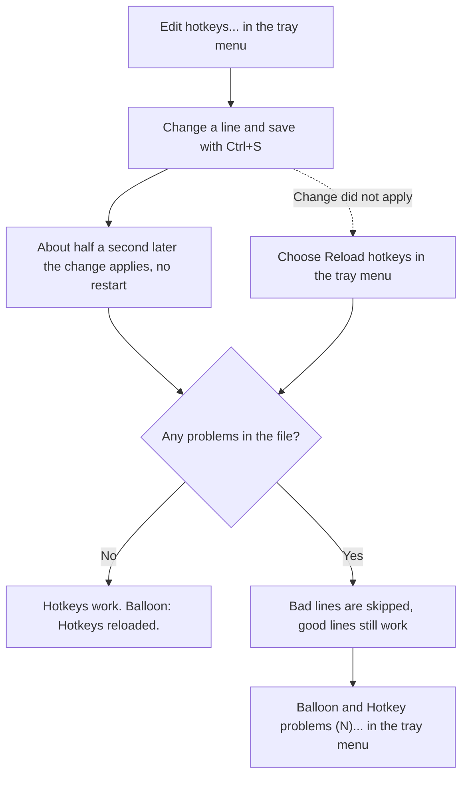

# Hotkeys and hotkeys.cfg

## Default hotkeys

| Action | Default shortcut | What it does |
|---|---|---|
| `ShowCalculator` | Ctrl+Alt+C | Shows the calculator |
| `ToggleActivity` | Ctrl+Alt+M | Starts or stops the mouse mover |
| `SnipAndEdit` | Ctrl+Alt+S | Takes a snip, then opens the snip editor |
| `SnipRegion` | Ctrl+Alt+Shift+S | Takes a snip to the clipboard |
| `SnipText` | Ctrl+Alt+T | Takes a snip and copies the text in it, as text |
| `DiagramEditor` | Ctrl+Alt+D | Opens a new diagram editor window |
| `CheckFolder` | none | Pick a folder, check the C# standard |
| `FixFolder` | none | Pick a folder, fix it in place |
| `EditHotkeys` | none | Opens `hotkeys.cfg` in the config editor |
| `EditActivitySettings` | none | Opens `activity.cfg` in the config editor |
| `EditScripts` | none | Opens the first script in the config editor |
| `OpenScriptsFolder` | none | Opens `config\scripts` in Explorer |
| each script | none | Runs the script |

Hotkeys work in the same way whichever window is active, including My Tools' own windows. Holding a hotkey down does not repeat it.

## The generated hotkeys.cfg

On a fresh install the app creates this file. Actions without a default shortcut are written as comments.

```
# MyTools hotkeys: one line per hotkey, Action = Shortcut. Changes apply when you save.
# Modifiers: Ctrl, Alt, Shift, Win.
# Keys: A-Z, 0-9, F1-F24, NumPad0-NumPad9, Space, Enter, Esc, Tab, Delete, Insert, Home, End,
#       PageUp, PageDown, Up, Down, Left, Right, PrintScreen, Plus, Minus.
#       Or the character a key types, e.g. Ctrl+Alt+< (adds Shift if it needs it).
# A line starting with # is ignored: remove the # to turn a hotkey on, add it to turn one off.
# A script can get a value after the shortcut (script.argument()), one line per value:
#   PrTemplate = Ctrl+Alt+1, app1
#   PrTemplate = Ctrl+Alt+2, app2

# CheckFolder = Ctrl+Alt+
DiagramEditor = Ctrl+Alt+D
# EditActivitySettings = Ctrl+Alt+
# EditHotkeys = Ctrl+Alt+
# EditScripts = Ctrl+Alt+
# FixFolder = Ctrl+Alt+
# GoogleSearch = Ctrl+Alt+
# OpenScriptsFolder = Ctrl+Alt+
ShowCalculator = Ctrl+Alt+C
SnipAndEdit = Ctrl+Alt+S
SnipRegion = Ctrl+Alt+Shift+S
SnipText = Ctrl+Alt+T
ToggleActivity = Ctrl+Alt+M
```

The file is created only if it does not exist.

## How to change a hotkey

1. Right-click the tray icon and choose **Edit hotkeys...**.
2. Change a line, or remove the `#` from a commented line and finish the shortcut, for example `GoogleSearch = Ctrl+Alt+G`.
3. Save with **Ctrl+S**.

The change applies about half a second after the file is saved, with no restart. If it does not, choose **Reload hotkeys** from the tray menu. A balloon "Hotkeys reloaded." confirms a clean reload.

The diagram below shows what happens after you change a hotkey.



To turn a hotkey off, put `#` at the start of its line.

## Line format

- One hotkey per line: `Action = Shortcut`.
- The action name is made of letters, digits and `_`. Action names are not case sensitive.
- Blank lines are fine.
- A `#` at the start of a line makes the line a comment. A `#` after the shortcut starts a comment only when it begins the value or follows a space.
- Each action may appear only once, except script actions with different arguments (see below).

## Shortcut syntax

- Join the parts with `+`. Spaces around parts and letter case do not matter.
- **Modifiers:** `Ctrl` (or `Control`), `Alt`, `Shift`, `Win` (or `Windows`).
- **Keys:**
  - letters `A` to `Z` and digits `0` to `9`;
  - `F1` to `F24` and `NumPad0` to `NumPad9`;
  - `Space`, `Enter` (or `Return`), `Esc` (or `Escape`), `Tab`, `Backspace`, `Del` (or `Delete`), `Ins` (or `Insert`), `Home`, `End`, `PageUp` (or `PgUp`), `PageDown` (or `PgDn`), `Up`, `Down`, `Left`, `Right`, `PrintScreen` (or `PrtSc`), `Pause`;
  - `Plus` and `Minus`;
  - a single character as typed by your current keyboard layout, such as `<`. Shift is added if your layout needs it.
- A shortcut needs at least one modifier, except for `F1` to `F24`.
- A modifier key cannot be the main key.
- Use `Plus` for the + key. Typing a bare `+` as the key gives an error.
- A character typed with AltGr is refused, and so is `AltGr` itself: Windows sees it as Ctrl+Alt, so a hotkey on it would stop you from typing those characters. Scripts can still press it with `keyboard.press("AltGr+...")` (see [Scripts](08-scripts.md)).

## Script hotkeys with a value

A script can receive a value typed after the shortcut, separated by a comma. Each line needs its own shortcut:

```
OpenSite = Ctrl+Alt+1, example.com
OpenSite = Ctrl+Alt+2, wikipedia.org
```

The text after the first comma (that is not the shortcut's own key) is trimmed, and its letter case is kept. Only script actions accept a value. For example, `Ctrl+,, app1` means the shortcut `Ctrl+,` with the value `app1`. An empty value after a trailing comma is ignored.

## Hotkey problems

A bad line never blocks the good ones. Each bad line is reported and skipped, and every other line still works. Problems appear in three places:

- a balloon titled "My Tools: some hotkeys are off", listing the first 3 problems, then "...and N more.", then "Tray menu: Hotkey problems, Edit hotkeys.";
- the tray item **Hotkey problems (N)...**, which opens a warning box titled "My Tools: some hotkeys are off" with all problems;
- the problem list at the bottom of the config editor, while you edit.

**Messages.** `<name>` is the action name.

| Message | Meaning |
|---|---|
| `<name>: unknown action. Actions: <list>.` | No action has that name. The message lists the valid ones. |
| `<name>: set more than once; the first line is used.` (when a value was given, ` with <argument>` is added after the name, before the colon) | The same action appears twice. The first line wins, even if it was the invalid one. |
| `<name>: <shortcut> is already used by <other action>.` | Two actions share a shortcut. The later one is skipped. |
| `<name>: <shortcut> is not available. <Windows error text>` | Windows refused the shortcut, usually because another program owns it. Tray list only. |
| `<name>: takes no value after the shortcut (<argument>).` | You gave a value to an action that is not a script. Tray list only. |
| `Line N: '<text>' is not 'Action = Shortcut'.` | The line is not in `Name = Value` form. |
| `<name>: the [" is never closed, so the rest of the file is ignored.` | A value starting with `["` has no closing `"]`. Everything after that line is lost. |
| `Could not use <path>, so the default hotkeys are used: <reason>` | The file could not be read or written, so the built-in defaults are used. Tray list only. |

**Shortcut messages** (shown after `<name>: `):

- `No shortcut.`
- `'<text>' has an empty part; use Plus for the + key.`
- `'<text>' has more than one key.`
- `'<part>' is not a key.`
- `'<text>' has no key, only modifiers.`
- `'<text>' needs a modifier (Ctrl, Alt, Shift or Win).`
- `No key types '<c>' on the current keyboard layout.`
- `'<c>' is typed with AltGr, and a hotkey on its key would stop you from typing it.`
- `'<text>' has AltGr, which can't be part of a hotkey: Windows sees it as Ctrl+Alt.`

The app does not retry a shortcut Windows refused. Free the shortcut in the other program, or pick another one, then choose **Reload hotkeys**.

---

← Previous: [Getting Started](01-getting-started.md) | [Contents](README.md) | Next: [Calculator](03-calculator.md) →
