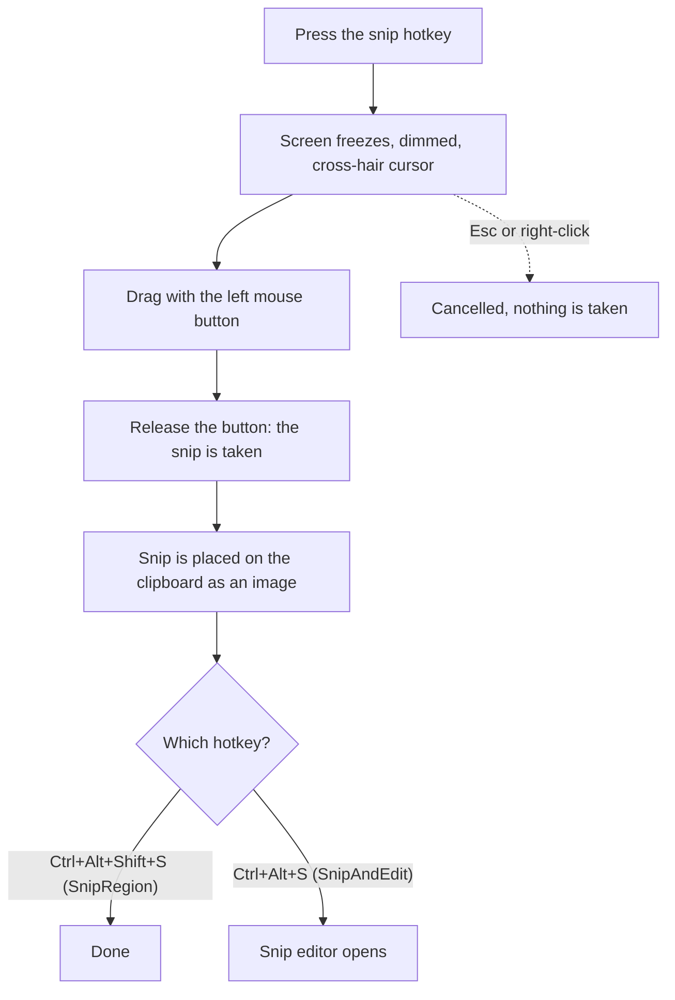

# Snipping and the Snip Editor

There are three ways to take a snip, and one to record a video.

| Hotkey | Action | Result |
|---|---|---|
| **Ctrl+Alt+Shift+S** | `SnipRegion` | The area you select is placed on the clipboard as an image. |
| **Ctrl+Alt+S** | `SnipAndEdit` | The same snip, then the **Snip editor** opens so you can mark it up. |
| **Ctrl+Alt+T** | `SnipText` | The text in the area you select is placed on the clipboard as text. See [Copying the text in a snip](#copying-the-text-in-a-snip). |
| **Ctrl+Alt+R** | `RecordScreen` | Records a video of the area you select, until you press Ctrl+Alt+R again. See [Recording a video](#recording-a-video). |

## Selecting an area

When you press the hotkey, the whole screen (all monitors) freezes and is shown dimmed with a cross-hair cursor.

1. Press the left mouse button and drag. The area you cover appears at normal brightness with a blue border and a label "W × H" showing its size in pixels.
2. **Release the button.** The snip is taken at once. You cannot move or resize the selection afterwards.

To cancel, press **Esc** or click the **right mouse button**. A drag smaller than 2 pixels in either direction selects nothing and the overlay stays. Clicking away so the overlay loses focus also cancels it (not during the first second after it opens). No hint text is shown on the overlay. Pressing the hotkey again while a snip is open is ignored.

The diagram below shows the steps of taking a snip.

## The Snip editor window

The window is titled "Snip editor". It opens at the snip's size (at most 90% of the usable area of the screen your mouse is on), centered on that screen. The snip is shown at 100%; a larger snip gets scroll bars. There is no zoom. The minimum window size is 480 by 200 pixels.

**Your clipboard is replaced.** The snip is placed on the clipboard as soon as the editor opens, and again after every change. Whatever the clipboard held before is gone. **Save** writes a file and does not change the clipboard.

**Several snips in one window.** If the editor is already open, a new snip is added to the same window. Earlier snips stay until you close the window. Browse them with the `<` and `>` buttons (tooltips "Previous snip of this window (Alt+Left)" and "Next snip of this window (Alt+Right)"). An "n / m" label shows where you are; its tooltip reads "The snips stay here until this window closes". Each snip keeps its own drawings and its own undo history. A minimized editor is restored when a new snip arrives.

**Closing.** Close with the X button, or press **Esc** when nothing is selected. The editor does not ask anything. All snips and drawings are lost; the clipboard keeps the last copied image.

## Tools

| Tool | Key | Tooltip |
|---|---|---|
| Select | V | "Select (V): click what's drawn, then drag it or its handles, arrow keys to move it, Delete to remove it, double-click a text to edit it" |
| Pen | P | "Pen (P)" |
| Highlighter | H | "Highlighter (H)" |
| Arrow | A | "Arrow (A)" |
| Rectangle | R | "Rounded rectangle (R)" |
| Text | T | "Text (T): click where it goes, Enter to end, Esc to end and select it, Shift+Enter for a new line" |
| Blur | B | "Blur (B): drag over what to hide. It can't be recovered from the copied or saved image" |
| Emoji | E | "Emoji (E): click where it goes; pick which one from the emoji list beside the sizes" |

**Blur** is not a true blur. The covered area is replaced by the average color of the pixels just outside it, with a fixed cloudy pattern. Nothing from the covered pixels is kept, so it cannot be reversed from the copied or saved image. Blur has no color, size or transparency choices.

**Emoji** drops an emoji, in its own colors as Windows shows them, where you click, and again at each click. Choose which one from the emoji list that shows beside the sizes while the tool is chosen: at its top, **Used last** has the 10 emoji you dropped most recently, newest first, and below are all of them by group: Faces, Gestures, Marks and arrows, Work, Hearts and symbols, Nature and food. Picking one from the list also chooses the tool. With an emoji selected, picking another one changes it. An emoji has no color choice, but it has a size, from 16 to 200 pixels, and a transparency. The emoji chosen and the ones used last are remembered between runs. Flags are not offered: Windows draws them as two letters.

## Toolbar choices

- **Color of this tool** (a drop-down): a palette of 24 colors, plus "More colors...". Up to 8 custom colors are remembered, newest first.
- **Line width, or text size, in pixels (- and +)**: line widths 1, 2, 3, 4, 5, 6, 8, 10, 12, 16, 20, 24, 32, 40, 48; text sizes 10, 12, 14, 16, 18, 20, 24, 28, 32, 36, 48, 64, 72. Emoji sizes 16, 20, 24, 32, 40, 48, 64, 80, 96, 128, 160, 200 (48 at first).
- **Transparency**: 0 to 90% in steps of 10.
- **Arrow heads:** "Head at the end", "Head at the start", "Heads at both ends".
- **Text edge:** an "Edge" color drop-down and an edge width list ("No edge" for 0, otherwise "N px": 0, 1, 2, 3, 4, 5, 6, 8, 10, 12).
- Buttons for Undo, Redo, Copy, Copy text and Save.

Defaults: the Pen is the starting tool unless you used another last time. Pen, Arrow and Rectangle are 4 px, the Highlighter is 16 px, 50% transparent and yellow, and Text is 24 px. Everything else starts red. Arrow heads start at the end, and the text edge starts off with white as the edge color. Each tool remembers its own color, size and transparency between runs.

## Keys in the editor

| Key | Effect |
|---|---|
| Ctrl+Z | Undo |
| Ctrl+Y or Ctrl+Shift+Z | Redo |
| Ctrl+C | Copy the snip with its drawings to the clipboard |
| Ctrl+Shift+C | Copy the text in the snip, as text |
| Ctrl+S | Save |
| Alt+Left / Alt+Right | Previous / next snip |
| `-` or `[` | Next smaller size |
| `+` or `]` | Next larger size |
| V, P, H, A, R, T, B, E | Choose a tool |
| Esc | Ends a text being typed; else deselects the selection; else closes the editor |
| Enter / Shift+Enter | End a text / start a new line in a text |

While you are typing a text, these keys belong to the text. When the text ends they work again right away. When you end a text with Esc, an empty text is dropped; otherwise the text is kept and selected.

## Select tool

Choose Select (V), or end a text with Esc.

- **Select:** click a drawing. Lines and rectangle outlines are selected by clicking on the line (the empty inside of a rectangle does not count). Texts, blurs and highlighted areas are selected anywhere in their box. An arrow can be selected on its line or on its head(s).
- **Move:** drag it, or use the arrow keys (10 px; with Shift, 1 px).
- **Scale:** drag one of the small white square handles. A box shows 8 handles (4 corners and 4 edge middles). An arrow shows only its two end points. Where handles overlap, the nearest one is used. There is no rotation.
  - A text changes its font size.
  - A pen line is scaled and its width changes with it.
  - A highlighter line becomes a highlighted area.
  - With several drawings selected, the frame around them all has the 8 handles and scales them together: each keeps its place in the frame. Texts and step numbers grow or shrink around their middle, and arrows move their ends with the frame. Line widths stay as they are.
- **Edit a text:** double-click it.
- **Delete:** press Delete or Backspace.
- **Right-click** a drawing for the menu "Reset to original" and "Delete". "Reset to original" returns that one drawing to how it was first drawn, however many changes it had. It is enabled only when the drawing has changed.
- While a drawing is selected, the toolbar shows and changes its color, size, transparency, arrow heads and text edge instead of the tool's.
- Every change can be undone with Ctrl+Z. Esc deselects.

## Recording a video

Press **Ctrl+Alt+R** (`RecordScreen`) and drag over the area to record, as for a snip. Recording starts when you release the button:

- A red frame shows the area, and a small bar below it (or above, when there's no room) shows how long it has recorded. Drag the bar by its time to move it. Neither is in the video, and the bar doesn't take the focus from the program you record.
- To stop, press **Ctrl+Alt+R** again or click **Stop** on the bar. After a moment, a dialog titled "Save recording" asks where to save the video, starting in your Videos folder with the name `Recording yyyy-MM-dd HHmmss.mp4`. Cancel deletes it.

The video is an MP4 (H.264), recorded at 20 frames a second with the encoder built into Windows, using the graphics card when it can. It plays in any video player and in browsers. It has the mouse pointer, as it was on the screen, but no sound. When a program hides the pointer, as some do while you type, the video doesn't show it either. Its width and height are made even, which the encoder needs, so an area 1 pixel off loses that pixel. While the video is recorded, it's kept in your temporary folder.

If Windows can't record, a notification says why.

## Copying the text in a snip

My Tools can read the text in a snip (OCR) and put it on the clipboard as text, to paste anywhere. It uses the text recognition built into Windows, so nothing leaves your computer.

- **Ctrl+Alt+T** (`SnipText`): select an area as for any snip. Its text goes on the clipboard, and a notification says "Copied N lines of text." The image is not copied, and no window opens.
- In the snip editor, click **Copy text** or press **Ctrl+Shift+C**. It reads the snip as it is shown: cropped, with your drawings. A blurred area stays unreadable, and text you added is read too. A note under the button says how many lines were copied. The next change in the editor copies the image again, replacing the text on the clipboard.

Each line of text on the screen becomes one line, top to bottom, indented with spaces as far as it is in the snip, so code keeps its indentation. Tables and columns come out as plain lines, without their layout. Handwriting isn't read.

Some editors draw a dot for each space, such as Visual Studio with **View White Space** on. Those dots are left out of the text. A dot first on a line, before a word, is kept as a bullet. Code still reads best with them turned off (in Visual Studio, **Ctrl+R, Ctrl+W**).

If nothing could be read, you are told "No text found in the snip." Very small text, or text on a busy background, may be read with mistakes or not at all: zoom in on it before you snip it. Code is harder than ordinary text: expect a few wrong letters, such as `I` for `l`.

Windows reads the languages you have added in **Settings > Time & language > Language & region**, using the first one in that list that it can read. If none of them can be read, you are told so. Add a language there, with its **Optical character recognition** feature.

The hotkey **Ctrl+Alt+T** is in the `hotkeys.cfg` that a new install creates. If your `hotkeys.cfg` is older, add the line `SnipText = Ctrl+Alt+T` yourself: see [Hotkeys](02-hotkeys.md).

## Saving

Press **Ctrl+S** or click **Save**. The dialog is titled "Save snip", with the file types "PNG image (*.png)", "JPEG image (*.jpg)" and "Bitmap (*.bmp)" (PNG first). It starts in `Pictures\Screenshots` if that folder exists, otherwise in `Pictures`, and suggests the name `Snip yyyy-MM-dd HHmmss.png`, which is the date and time of the save. For example, `Snip 2026-11-04 153012.png` is a snip saved on 4 November 2026 at 15:30:12. The file extension decides the format; any other extension saves a PNG.

Your tool choices are saved in `config\snipeditor.json` after every change. If that file is missing or damaged, the defaults are used.

---

← Previous: [Calculator](03-calculator.md) | [Contents](README.md) | Next: [Diagram Editor](05-diagram-editor.md) →
