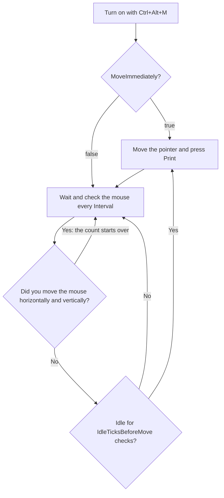

# Mouse Mover and Keep Awake

Two separate toggles, each on or off whatever the other is:

| Toggle | Hotkey | Tray menu | What it does |
|---|---|---|---|
| **Mouse mover** | **Ctrl+Alt+M** (`ToggleActivity`) | **Mouse mover** | Moves the mouse pointer when you have been away, so you look present |
| **Keep awake** | **Ctrl+Alt+K** (`ToggleKeepAwake`) | **Keep awake** | Keeps the computer awake and the screen on, even with the screen locked. See [Keeping the computer awake](#keeping-the-computer-awake). |

- The tray menu items are ticked while their toggle is on, and the tray icon's tooltip says which are on: "Mouse mover on", "Keeping awake".
- While the mouse mover is on, the tray icon is **red**. No balloon announces it; the red icon is how you tell.
- Keep awake shows a balloon when you turn it on or off.
- Neither stops on its own, not for screen lock or sleep. Each stops when you turn it off or exit the app.

## What it does

The app checks the mouse position every `Interval` milliseconds. When you have not moved the mouse for long enough, it:

1. picks a random point inside the window under the pointer;
2. glides the pointer there in about ten steps, taking roughly 0.4 to 1.0 second with the default speeds;
3. presses the **Print** key each time it acts. This is the Print key, not Print Screen. What the foreground program does with it is up to that program. The settings file's own comment says it moves the mouse "while you are away"; it also presses the Print key every time.

Things to know:

- "You moved the mouse" means the pointer changed **both** its horizontal and vertical position between two checks. A purely horizontal or purely vertical movement is not noticed. Typing is never noticed.
- The time between moves is about `Interval x IdleTicksBeforeMove`. With the defaults, 5000 x 20, that is 100 seconds of inactivity.
- With `MoveImmediately = true` (default), it moves as soon as you turn it on. With `false`, the first move comes after the full wait.
- If it cannot read the window under the pointer, it does nothing that time and tries again at the next check.

The diagram below shows the repeating cycle once the mouse mover is on.



## Keeping the computer awake

**Keep awake** (**Ctrl+Alt+K**, or **Keep awake** in the tray menu) asks Windows to keep the computer awake and the screen on, as a program playing a video does, until you turn it off. Nothing touches your mouse or keyboard, and it works **also while the screen is locked**. It has no settings.

The two toggles cover each other's gaps, so turn on one or both:

| Turned on | Covers | Doesn't cover |
|---|---|---|
| **Keep awake** alone | Sleep and the screen turning off, also while locked. Good for a long download, with the pointer never moving. | The screen saver, the lock after the time without input, and "Away" in chat programs such as Teams: those count only real input. |
| **Mouse mover** alone | Sleep, the screen turning off, the screen saver, the lock, and "Away" in chat programs | Nothing once the screen is locked: Windows doesn't let programs send input to the lock screen, so the computer can then go to sleep. |
| Both | All of the above | |

When keep awake is turned off, or My Tools exits, Windows' usual sleep and screen settings apply again.

To keep the computer awake from the moment My Tools starts with Windows, add `Run = ToggleKeepAwake` to `startup.cfg`: see [Startup actions](01-getting-started.md#startup-actions).

## activity.cfg

The file `config\activity.cfg` holds the mouse mover's settings. It is created with the defaults when you first turn the mover on or open it in the config editor. Open it with **Edit activity settings...**. It is read each time you turn the mover on, so edits apply the **next time** it starts, not while it runs.

```
# MyTools mouse mover (the ToggleActivity hotkey, Ctrl+Alt+M): moves the mouse while you are
# away, so you look present: no screen saver, no lock after the time without input, no Away in
# chat programs. Keeping the computer awake is separate: ToggleKeepAwake, Ctrl+Alt+K.
# Changes apply the next time you turn it on.
#
# How the mouse is moved:
# Interval: milliseconds between checks of the mouse (100 to 3600000).
# IdleTicksBeforeMove: checks to wait after you move the mouse before it moves again.
#   The wait is about Interval x IdleTicksBeforeMove: 5000 x 20 is 100 seconds.
# SpeedMin, SpeedMax: how slow a move is, picked at random between the two (20 to 100).
#   Higher is slower, so SpeedMin is the fastest. SpeedMin can't be above SpeedMax.
# MoveImmediately: true to move the mouse as soon as you turn it on; false to wait first,
#   as after you move the mouse.

Interval = 5000
IdleTicksBeforeMove = 20
SpeedMin = 40
SpeedMax = 100
MoveImmediately = true
```

| Setting | Meaning | Allowed | Default |
|---|---|---|---|
| `Interval` | Milliseconds between checks | whole number 100 to 3,600,000 | 5000 |
| `IdleTicksBeforeMove` | Checks to wait after the mouse was moved by you | whole number 0 to 100,000 | 20 |
| `SpeedMin` | Fastest move; higher is slower | whole number 20 to 100, not above `SpeedMax` | 40 |
| `SpeedMax` | Slowest move | whole number 20 to 100 | 100 |
| `MoveImmediately` | Move as soon as turned on (`true`) or wait first (`false`) | `true` or `false` | `true` |

Names are not case sensitive. In this file, a `#` anywhere ends the value, so `Interval = 5000 # note` works.

An older `activity.cfg` may have `MoveMouse` and `KeepAwake` lines, from when the mouse mover also kept the computer awake. They are ignored now, without a problem: the mouse mover always moves the mouse, and keeping awake is its own toggle. You can delete them.

**Timing examples.**

- `Interval = 1000`, `IdleTicksBeforeMove = 30`: a move after 30 seconds of inactivity.
- `Interval = 60000`, `IdleTicksBeforeMove = 5`: a move after 5 minutes (300 seconds).
- `MoveImmediately = false` with the defaults: the first move comes after 100 seconds.

**Problems.** When you turn the mover on, problems in the file appear as one warning balloon titled `activity.cfg`, one line per problem. Bad values fall back to the defaults. The editor shows the same messages with a "Line N: " prefix.

- `<name>: unknown setting. Settings: Interval, IdleTicksBeforeMove, SpeedMin, SpeedMax, MoveImmediately.`
- `<name>: set more than once; the first line is used.`
- `<name>: must be true or false; the default is used.`
- `<name>: must be a whole number from <min> to <max>; the default is used.`
- `Line N: '<text>' is not 'Name = Value'.`
- `SpeedMin (a) is above SpeedMax (b); the defaults are used.` (both go back to 40 and 100)
- `<name>: the [" is never closed, so the rest of the file is ignored.`
- `Could not use <path>, so the default settings are used: <reason>` (balloon only)

---

← Previous: [Diagram Editor](05-diagram-editor.md) | [Contents](README.md) | Next: [Config Editor](07-config-editor.md) →
