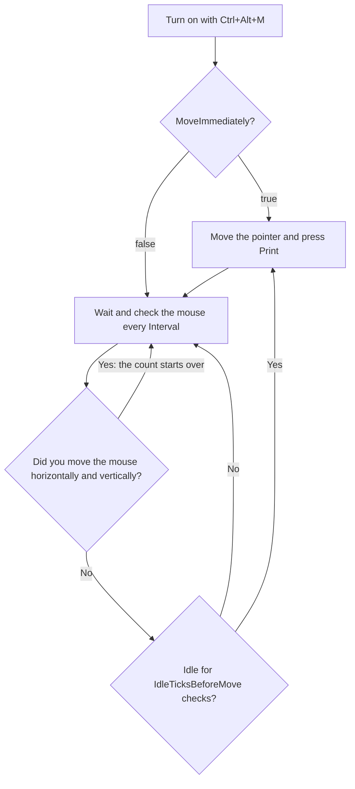

# Mouse Mover (Activity)

Activity keeps your computer looking active by moving the mouse pointer when you have been away, and keeps it awake, even with the screen locked. Turn it on and off with **Ctrl+Alt+M** (action `ToggleActivity`). Each of the two can be turned off in `activity.cfg`: see [Moving the mouse, keeping awake, or both](#moving-the-mouse-keeping-awake-or-both).

- While it is on, the tray icon is **red**. When you turn it off, the normal icon returns.
- No balloon announces that it is on or off. The red icon is how you tell.
- It does not stop on its own, not for screen lock or sleep. It stops when you press the hotkey again or exit the app.

## What it does

The app checks the mouse position every `Interval` milliseconds. When you have not moved the mouse for long enough, it:

1. picks a random point inside the window under the pointer;
2. glides the pointer there in about ten steps, taking roughly 0.4 to 1.0 second with the default speeds;
3. presses the **Print** key each time it acts. This is the Print key, not Print Screen. What the foreground program does with it is up to that program. The settings file's own comment says it moves the mouse "while you are away"; it also presses the Print key every time.

Things to know:

- "You moved the mouse" means the pointer changed **both** its horizontal and vertical position between two checks. A purely horizontal or purely vertical movement is not noticed. Typing is never noticed.
- The time between moves is about `Interval x IdleTicksBeforeMove`. With the defaults, 5000 x 20, that is 100 seconds of inactivity.
- With `MoveImmediately = true` (default), it moves as soon as you turn it on. With `false`, the first move comes after the full wait.
- If it cannot read the window under the pointer, it does nothing that time and tries again at the next check.

The diagram below shows the repeating cycle once the mouse mover is on.



## Moving the mouse, keeping awake, or both

Activity does two things, each turned on or off in `activity.cfg`:

| Setting | What it does | Covers |
|---|---|---|
| `MoveMouse = true` | Moves the pointer while you are away, as described above | Sleep, the screen turning off, the screen saver, the lock after the time without input, and "Away" in chat programs such as Teams |
| `KeepAwake = true` | Asks Windows to keep the computer awake and the screen on, as a program playing a video does. Nothing touches your mouse or keyboard | Sleep and the screen turning off, **also while the screen is locked** |

Both are on by default, and turning activity on with **Ctrl+Alt+M** does both. They cover each other's gaps:

- **KeepAwake alone** doesn't stop the screen saver, the lock, or "Away" in chat programs, since those count only real input. Use `MoveMouse = false` and `KeepAwake = true` when you want the computer to stay on, such as for a long download, without the pointer ever moving.
- **MoveMouse alone** stops working once the screen is locked: Windows doesn't let programs send input to the lock screen, so the computer can then go to sleep. That's how activity worked before these settings; `KeepAwake = false` brings it back.

They can't both be false, since activity would then do nothing. That's a problem shown when you turn activity on, and the mouse is moved.

When activity is turned off, or My Tools exits, Windows' usual sleep and screen settings apply again.

## activity.cfg

The file `config\activity.cfg` is created with the defaults when you first turn the mover on or open it in the config editor. Open it with **Edit activity settings...**. It is read each time you turn the mover on, so edits apply the **next time** it starts, not while it runs.

```
# MyTools activity (the ToggleActivity hotkey, Ctrl+Alt+M).
# Changes apply the next time you turn it on.
#
# MoveMouse: true to move the mouse while you are away, so you look present: no screen saver,
#   no lock after the time without input, no Away in chat programs.
# KeepAwake: true to keep the computer from sleeping and the screen on, even with the screen
#   locked, where the mouse can't be moved. Nothing touches the mouse or the keyboard.
#   One of the two must be true.
#
# How the mouse is moved:
# Interval: milliseconds between checks of the mouse (100 to 3600000).
# IdleTicksBeforeMove: checks to wait after you move the mouse before it moves again.
#   The wait is about Interval x IdleTicksBeforeMove: 5000 x 20 is 100 seconds.
# SpeedMin, SpeedMax: how slow a move is, picked at random between the two (20 to 100).
#   Higher is slower, so SpeedMin is the fastest. SpeedMin can't be above SpeedMax.
# MoveImmediately: true to move the mouse as soon as you turn it on; false to wait first,
#   as after you move the mouse.

MoveMouse = true
KeepAwake = true
Interval = 5000
IdleTicksBeforeMove = 20
SpeedMin = 40
SpeedMax = 100
MoveImmediately = true
```

| Setting | Meaning | Allowed | Default |
|---|---|---|---|
| `MoveMouse` | Move the mouse while you are away | `true` or `false` | `true` |
| `KeepAwake` | Keep the computer awake and the screen on | `true` or `false` | `true` |
| `Interval` | Milliseconds between checks | whole number 100 to 3,600,000 | 5000 |
| `IdleTicksBeforeMove` | Checks to wait after the mouse was moved by you | whole number 0 to 100,000 | 20 |
| `SpeedMin` | Fastest move; higher is slower | whole number 20 to 100, not above `SpeedMax` | 40 |
| `SpeedMax` | Slowest move | whole number 20 to 100 | 100 |
| `MoveImmediately` | Move as soon as turned on (`true`) or wait first (`false`) | `true` or `false` | `true` |

Names are not case sensitive. In this file, a `#` anywhere ends the value, so `Interval = 5000 # note` works.

**Timing examples.**

- `Interval = 1000`, `IdleTicksBeforeMove = 30`: a move after 30 seconds of inactivity.
- `Interval = 60000`, `IdleTicksBeforeMove = 5`: a move after 5 minutes (300 seconds).
- `MoveImmediately = false` with the defaults: the first move comes after 100 seconds.

**Problems.** When you turn the mover on, problems in the file appear as one warning balloon titled `activity.cfg`, one line per problem. Bad values fall back to the defaults. The editor shows the same messages with a "Line N: " prefix.

- `<name>: unknown setting. Settings: Interval, IdleTicksBeforeMove, SpeedMin, SpeedMax, MoveImmediately, MoveMouse, KeepAwake.`
- `MoveMouse and KeepAwake are both false, so activity would do nothing; the mouse is moved.`
- `<name>: set more than once; the first line is used.`
- `<name>: must be true or false; the default is used.`
- `<name>: must be a whole number from <min> to <max>; the default is used.`
- `Line N: '<text>' is not 'Name = Value'.`
- `SpeedMin (a) is above SpeedMax (b); the defaults are used.` (both go back to 40 and 100)
- `<name>: the [" is never closed, so the rest of the file is ignored.`
- `Could not use <path>, so the default settings are used: <reason>` (balloon only)

---

← Previous: [Diagram Editor](05-diagram-editor.md) | [Contents](README.md) | Next: [Config Editor](07-config-editor.md) →
