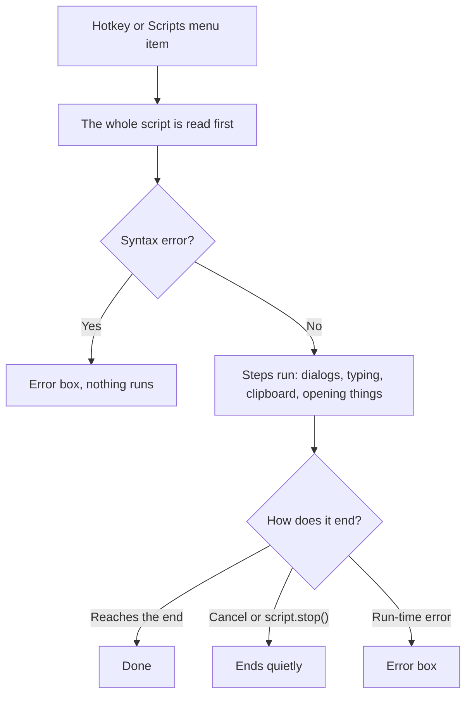

# Scripts

A **script** is a small text file that My Tools runs when you press its hotkey. It can ask you something, open a web page, start a program, use the clipboard, type text into the active window, and more.

Scripts are plain text files with the extension `.mts`, stored in `config\scripts` next to the exe.

```mts
query = dialog.ask("Search Google for:", clipboard.gettext())

if text.trim(query) != ""
    shell.open("https://www.google.com/search?q=" + text.urlencode(query))
end
```

**Warning.** Scripts can start programs, open any file or address, type keys into the active window, and read and replace the clipboard. There is no sandbox or permission check. Only run scripts you trust.

## Contents

- [Getting started](#getting-started)
- [The example script: GoogleSearch.mts](#the-example-script-googlesearchmts)
- [The language](#the-language)
- [Functions](#functions)
- [Reusing scripts](#reusing-scripts)
- [Examples](#examples)
- [Errors](#errors)
- [Limits](#limits)

## Getting started

### Where scripts live

Scripts are the `.mts` files in the `config\scripts` folder next to `CincoVertice.MyTools.Ui.Win.exe`. The first time My Tools starts, it creates the folder with an example, `GoogleSearch.mts`.

To edit them, use the tray menu: **Scripts > Edit scripts...**. The [config editor](07-config-editor.md) colors the script, underlines the first syntax error while you type, and can add new scripts with **New script...**. **Scripts > Open scripts folder** opens the folder, if you'd rather use another text editor.

### Running a script

- **From the tray menu:** **Scripts > *name***. Scripts are listed sorted by name.
- **With a hotkey:** open hotkeys.cfg from the tray menu (**Edit hotkeys...**), add a line with the script's name and a shortcut, and save the file:

  ```
  GoogleSearch = Ctrl+Alt+G
  ```

The script's name is its file name without `.mts`, keeping only ASCII letters, digits and `_`: `Google Search.mts` is `GoogleSearch`. A built-in action with the same name (such as `ShowCalculator`) keeps the hotkey. A file whose name starts with `_`, such as `_PrCommon.mts`, is a **library**, not a script you run: it is a piece other scripts include (see [Reusing scripts](#reusing-scripts)), so it is not in the menu and can't get a hotkey.

A hotkey line can pass a value to the script after a comma, which the script reads with `script.argument()`. One script can then have several hotkeys, one line each:

```
PrTemplate = Ctrl+Alt+1, app1
PrTemplate = Ctrl+Alt+2, app2
```

A `#` after a space starts a comment, so `app#1` is passed whole, but `app #1` passes only `app`.

If a hotkeys.cfg line can't be used (a misspelled name, or a shortcut another program already uses), My Tools shows a notification when it loads the hotkeys, and the tray menu gets a **Hotkey problems** item that lists every problem.

### When changes apply

- **Editing a script:** applies the next time it runs, because the file is read each time.
- **Saving hotkeys.cfg, or adding, renaming or deleting a script file:** My Tools reloads the hotkeys and the **Scripts** menu half a second later, and shows "Hotkeys reloaded" (or the problems it found). If it ever misses a change, use **Reload hotkeys** in the tray menu.

No restart is needed for any of these.

A script runs once at a time: pressing its hotkey again while it runs (for example, while it asks you something) does nothing.

### What happens when a script runs



## The example script: GoogleSearch.mts

This script is created with the app. It asks what to search for (starting with the text on your clipboard), then opens Google in your default browser.

```mts
# My Tools script. Bind it in hotkeys.cfg, e.g. GoogleSearch = Ctrl+Alt+G; it applies when you save.
# The action's name is the file name; changes to this file apply the next time it runs.
#
# Functions, by module (see docs/user-guide/08-scripts.md for details):
#   dialog.ask(prompt, default)  dialog.form(title, [prompts], [defaults])  dialog.message(text)
#   dialog.confirm(question)  clipboard.gettext()  clipboard.settext(text)  keyboard.type(text)
#   clipboard.clear()  clipboard.pasteastext()  window.title()
#   keyboard.press("Ctrl+V")  keyboard.press("Tab", 3)
#   shell.open(address or file)  shell.run(program, arguments)  tray.notify(text)
#   script.wait(ms)  script.stop()  system.waitidle(cpu %, disk %, quiet seconds, most minutes)
#   global.set(name, value)  global.get(name, default)  (kept between runs, in config\global.vars)
#   text.length  text.upper  text.lower  text.trim  text.replace(text, old, new)  text.contains(text, part)
#   text.urlencode  list.length(list)  list.contains(list, item)  number(value)  text(value)
# Lists:   [a, b, c]  list[1] is the first item  list + list
# Logic:   name = value   if ... elseif ... else ... end   == != < <= > >=   and or not   + - * / %
#
# To ask several things in one dialog:
#   answers = dialog.form("Search Google", ["Search for:", "Only on site:"], [clipboard.gettext(), ""])
#   query = answers[1]

query = dialog.ask("Search Google for:", clipboard.gettext())

if text.trim(query) != ""
    shell.open("https://www.google.com/search?q=" + text.urlencode(query))
end
```

How it works:

- `dialog.ask(...)` shows a dialog titled `My Tools: GoogleSearch` with the label "Search Google for:" and the clipboard text as the starting answer (empty if the clipboard has no text). **OK** stores the answer; **Cancel** ends the script quietly.
- `if text.trim(query) != ""` runs the next line only if the answer is not empty after trimming spaces.
- `shell.open(...)` opens the address in your default browser. `text.urlencode` makes the text safe for a web address, for example `a b&c` becomes `a%20b%26c`.

## The language

### Lines and comments

Each line is one step: storing a value, calling a function, or part of an `if`. `#` starts a comment, to the end of the line, also after code. Blank lines are ignored, and indentation is free.

```mts
# Say hello
name = "Ricky"
dialog.message("Hello " + name)
```

A line can continue inside parentheses `( )` or brackets `[ ]`, so long calls and lists can span lines:

```mts
shell.open("https://www.google.com/search?q="
    + text.urlencode("my tools"))
```

A line either stores a value (`name = ...`) or calls a function (`name(...)`). A function that returns a value may stand alone on its line; the value is discarded.

### Values

| Type | Examples | Notes |
|---|---|---|
| Number | `3`, `2.5`, `.5`, `-4` | Decimal numbers with a `.` (not `,`). Shown without trailing zeros: `10 / 4` is `2.5`. |
| Text | `"Hello"`, `""` | Double quotes only. Escapes: `\"` quote, `\\` backslash, `\n` new line, `\t` tab. For several lines, see [Multi-line texts](#multi-line-texts). |
| True or false | `true`, `false` | The result of comparisons; needed by `if`, `and`, `or`, `not`. |
| List | `[1, "two", true]`, `[]` | Items of any type, even lists. See [Lists](#lists). |

### Multi-line texts

A text of several lines goes between `"""` at the end of a line and a line starting with `"""`. It is taken exactly as written: quotes, `\` and `#` are plain characters (escapes don't work there), so you can paste a template in as it is.

```mts
signature = """
    Best regards,
    Ricky
    "My Tools" user
    """
clipboard.paste(signature)
```

The spaces before the closing `"""` are removed from every line, so the text can be indented with the script; above, the text starts with `Best`. A line may start further right (it keeps the extra spaces), but not further left. The closing line can go on, as in `""")` to end a call.

### Variables

`name = value` stores a value. Use the name to read it back. Names start with a letter or `_`, and can contain letters, digits and `_`, but not a `.`. Names are not case-sensitive: `Name` and `name` are the same variable.

```mts
count = 3
count = count + 1
dialog.message(count)
```

A variable can hold any type, and a new value replaces the old one. Reading a variable that was never set is an error.

### Operators

From lowest to highest priority:

| Operators | Meaning |
|---|---|
| `or` | True if either side is true. The right side is skipped when the left is true. |
| `and` | True if both sides are true. The right side is skipped when the left is false. |
| `not` | Turns true into false and false into true. |
| `==` `!=` `<` `<=` `>` `>=` | Compare two values. |
| `+` `-` | Add, subtract. `+` also joins texts and lists. |
| `*` `/` `%` | Multiply, divide, remainder. Dividing by zero is an error. |
| `-` (in front) | Negative: `-x`. |
| `[ ]` | A list item: `list[1]`. |

Use parentheses to change the order: `(1 + 2) * 3` is `9`.

**Joining text:** when either side of `+` is a text, both are joined as text, so `"Total: " + 3` is `"Total: 3"`, and `"x" + true` is `"xtrue"`.

**Comparing:**

- `==` and `!=` work on any values. Texts are case-sensitive (`"A" == "a"` is false), and a text never equals a number (`"1" == 1` is false). Lists are equal when all their items are equal.
- `<` `<=` `>` `>=` compare two numbers or two texts. Texts are compared character by character.
- Compare two values at a time: write `a < b and b < c`, not `a < b < c`.
- `=` stores a value; `==` compares. `if x = 1` is an error.

### if

```mts
size = number(dialog.ask("Size?", "10"))

if size < 10
    dialog.message("small")
elseif size < 100
    dialog.message("medium")
else
    dialog.message("large")
end
```

`elseif` and `else` are optional, and you can use as many `elseif` as you like. An `if` can contain another `if`. Every `if` needs its `end`. The condition must be true or false: `if "yes"` is an error, write `if answer == "yes"`.

Keywords (`if`, `elseif`, `else`, `end`, `and`, `or`, `not`, `true`, `false`) are not case-sensitive.

### Lists

```mts
sites = ["github.com", "google.com", "stackoverflow.com"]

dialog.message(sites[1])             # github.com: the first item is 1
dialog.message(list.length(sites))   # 3
dialog.message(sites + ["bing.com"])
```

- `list[n]` is item `n`, from `1` to `list.length(list)`. Other positions are an error that says how many items there are.
- Items can't be changed: `sites[1] = "x"` is an error. Build a new list instead.
- `list + list` joins two lists; `list.contains(list, item)` checks for an item.
- `dialog.message(list)` shows the items, as in `[github.com, google.com]`.

## Functions

Functions are grouped in modules: you call one as `module.function(...)`, as in `clipboard.gettext()`. Only the two conversions, `number()` and `text()`, are global, since they work on any value.

| Module | For | Functions |
|---|---|---|
| [`dialog`](#dialog) | Asking and showing | `ask` `form` `message` `confirm` |
| [`clipboard`](#clipboard) | The clipboard | `gettext` `settext` `clear` `paste` `pasteastext` |
| [`keyboard`](#keyboard) | Typing and pressing keys | `type` `press` |
| [`window`](#window) | The window you are in | `title` |
| [`shell`](#shell) | Web pages, files and programs | `open` `run` |
| [`tray`](#tray) | Notifications | `notify` |
| [`system`](#system) | The computer | `waitidle` |
| [`script`](#script) | The running script | `wait` `stop` `argument` `include` |
| [`global`](#global) | Values kept between runs | `set` `get` `has` `remove` `names` |
| [`text`](#text) | Working with text | `length` `upper` `lower` `trim` `replace` `contains` `urlencode` |
| [`list`](#list) | Working with lists | `length` `contains` |
| [Global](#conversions) | Conversions | `number` `text` |

Names are not case-sensitive: `Clipboard.GetText()` works too. A function that expects a text also accepts a number or true/false, which it turns into text: `dialog.message(5)` works. Functions that return nothing can't be stored or used in a calculation.

If a script uses a name from before the modules, the error says the new one, e.g. "Unknown function 'copy': it is now clipboard.settext()". A misspelled function lists what its module has, e.g. "Unknown function 'clipboard.copy': clipboard has clear, gettext, paste, pasteastext, settext".

### dialog

| Function | What it does | Returns |
|---|---|---|
| `dialog.ask(prompt)`<br>`dialog.ask(prompt, default)` | Shows a box to type one answer, filled with `default`. | The text typed. **Cancel stops the script.** |
| `dialog.form(title, prompts)`<br>`dialog.form(title, prompts, defaults)` | Shows **one** dialog with a box for each text in the list `prompts`, filled with the list `defaults`. Missing defaults start empty; a default that is a list makes a fixed list to pick from. | A list with the answers, in order. **Cancel stops the script.** |
| `dialog.message(text)` | Shows a message and waits for OK. | Nothing |
| `dialog.confirm(question)` | Asks a Yes/No question. | `true` for Yes, `false` for No |

Dialogs are titled `My Tools: <script name>` and open on top of the program you are in, with the keyboard focus, so you can type right away.

#### Asking several things at once with dialog.form

`dialog.form` asks several questions in **one** dialog, instead of one `dialog.ask` after another:

```mts
answers = dialog.form("New meeting note",
    ["Title:", "People:", "Room:"],
    ["Weekly sync", "", "Room 2"])

note_title = answers[1]
people = answers[2]
room = answers[3]

keyboard.type(note_title + "\nWith: " + people + "\nWhere: " + room)
```

It takes up to three values:

| Argument | What it is |
|---|---|
| `title` | The bold heading at the top of the dialog. The window itself is titled "My Tools: *script name*". |
| `prompts` | A list with the label of each box, top to bottom: `["Title:", "People:", "Room:"]` shows three boxes. It can't be empty. |
| `defaults` | Optional: a list with the starting text of each box, in the same order. A default that is itself a **list** makes that box a fixed list to pick from (see below). It can be shorter than `prompts`; the boxes without a default start empty. It can't be longer. |

In the dialog, the first box has the keyboard focus. **Tab** moves to the next box, **Enter** is OK and **Esc** is Cancel. Each box holds one line of text.

**Picking from a fixed list.** Give a list as the default of a box, and the box becomes a drop-down with only those items; the answer is the item picked. The first item starts selected, so put the most likely one first:

```mts
answers = dialog.form("Pull request for app1",
    ["Jira task:", "Color:"],
    [global.get("jira task", "DEV-700"), ["Red", "Blue", "Green"]])

color = answers[2]     # "Red", "Blue" or "Green"
```

To start with another item selected, give the items and the one to select as a pair, `[[items], selected]`. With `global`, the list remembers the last pick:

```mts
answers = dialog.form("Pull request",
    ["Jira task:", "App:"],
    [global.get("jira task", "DEV-700"), [["Finpro", "Mobile", "Life"], global.get("app", "Finpro")]])

global.set("app", answers[2])
```

When the item to select is not in the list (for example, it was removed from the list since), the first item is selected.

Text boxes and lists can be mixed in one form. A list of choices can't be empty. Its items can be numbers too, but the answer is still a text: `["1", "2"]` and `[1, 2]` both answer `"1"` or `"2"`.

`dialog.form` returns a **list** of the answers, in the order of the prompts: `answers[1]` is the first box. Give each answer a name, as above, so the rest of the script is easy to read. A few things to know:

- **Answers are always texts**, even when a number was typed. Use `number()` to calculate with one, and `text.trim()` to ignore spaces around it.
- **An empty box gives `""`**. Check it with `if answer == ""` when the box is required.
- **Cancel (or Esc, or closing the dialog) ends the script** quietly, like `dialog.ask`, so the lines after `dialog.form` only run after OK.
- **Defaults can come from anywhere**, e.g. `[clipboard.gettext(), window.title()]`.

Another example, with a number and a required box:

```mts
answers = dialog.form("Reminder", ["Remind me to:", "In how many minutes (1 to 10):"], ["Stretch", "5"])
what = text.trim(answers[1])
minutes = number(answers[2])

if what == ""
    dialog.message("Write what to remind you of.")
    script.stop()
end

tray.notify("OK, in " + minutes + " minutes")
script.wait(minutes * 60 * 1000)
dialog.message(what)
```

If the minutes box has something that isn't a number, `number()` stops the script with an error that says so. `script.wait` waits at most 10 minutes. [Search the web with one dialog](#search-the-web-with-one-dialog) has one more example.

### clipboard

| Function | What it does | Returns |
|---|---|---|
| `clipboard.gettext()` | Reads the text in the clipboard. | The text, or `""` when it has none. |
| `clipboard.settext(text)` | Puts text in the clipboard. An empty text clears it. | Nothing |
| `clipboard.clear()` | Empties the clipboard. | Nothing |
| `clipboard.paste(text)` | Pastes the text into the active window with Ctrl+V, then, about half a second later, puts back what the clipboard held. Much faster than `keyboard.type` for long texts, and editors don't auto-indent or auto-complete it. `clipboard.paste("")` does nothing. | Nothing |
| `clipboard.pasteastext()` | Pastes the clipboard's text without its formatting (fonts, colors, links, tables) into the active window, with Ctrl+V. Afterwards the clipboard holds what it had before, formatting included, so Ctrl+V still pastes the formatted version. Does nothing when the clipboard has no text, e.g. only a picture. | Nothing |

### keyboard

| Function | What it does |
|---|---|
| `keyboard.type(text)` | Types the text into the active window, as if from the keyboard. Every character comes out as written, whatever the keyboard layout: `@`, `ñ`, `€`, accents and emoji. `\n` presses Enter and `\t` Tab. It first waits (up to 3 seconds, then types anyway) for you to release the hotkey's Ctrl, Alt, Shift and Win keys, so your hotkey doesn't turn the text into shortcuts. |
| `keyboard.press(keys)`<br>`keyboard.press(keys, times)` | Presses keys in the active window, written as in hotkeys.cfg: `keyboard.press("Ctrl+V")` pastes, `keyboard.press("Tab", 3)` presses Tab 3 times (a whole number from 1 to 100). A key alone works too: `"Enter"`, `"Esc"`, `"Down"`. It can also hold `AltGr`, which hotkeys can't: `keyboard.press("AltGr+2")`. Like `type`, it first waits for you to release the hotkey's keys. |

`keyboard.press` presses keys; `keyboard.type` writes text. `keyboard.type("^v")` types the characters `^v` (`+`, `^` and `{` are typed as themselves), and `keyboard.press("Ctrl+V")` pastes. The program needs a moment to react to a key, so after `keyboard.press("Ctrl+C")` wait a little before reading the clipboard.

Typing blocks the app until it finishes. Typing into a program that runs as administrator may depend on Windows; My Tools does nothing special for it.

**Keyboard layouts.** `keyboard.type` sends each character itself, not the key that types it, so `keyboard.type("@")` writes `@` on a Spanish, English or any other layout, even when the window you type into has a different layout from My Tools, and characters with no key on your keyboard are typed too. A few programs read only real keys and ignore typed characters: some games, and some remote desktop and virtual machine windows. In those, use `clipboard.paste(text)` instead.

`keyboard.press` presses real keys, so what a key types still depends on the layout of the window it goes to: `keyboard.press("AltGr+2")` types `@` on a Spanish layout and nothing on an English (US) one, which has no AltGr. To write a character, use `keyboard.type`. Use `AltGr` in `keyboard.press` for shortcuts that need that key, or for a dead key that a layout puts on AltGr, pressed before the letter it changes. `AltGr` can't go with `Ctrl` or `Alt`, since to Windows it already is Ctrl+Alt. A character that needs AltGr, such as `keyboard.press("@")` on a Spanish layout, is refused with `'@' is typed with AltGr; to write it, type it as text, or press AltGr and its key.`, because it would type `@` only on that layout.

### window

| Function | Returns |
|---|---|
| `window.title()` | The title of the active window, the one you are working in, e.g. `"Inbox - Outlook"`. `""` when it has none. |

With a hotkey, the active window is the program you pressed it in. Read the title at the start of the script: while a dialog of the script is open, the dialog is the active window. From the tray menu, the active window is usually the taskbar, so the title is `""`.

To do something only in one program, check part of the title, since the rest changes with the document:

```mts
if not text.contains(window.title(), "Visual Studio Code")
    tray.notify("This hotkey only works in VS Code")
    script.stop()
end

keyboard.press("Ctrl+Shift+P")
```

### shell

| Function | What it does |
|---|---|
| `shell.open(target)` | Opens a web address in the browser, or a file or folder in its default program: `shell.open("https://github.com")`, `shell.open("C:\\notes.txt")`. |
| `shell.run(program)`<br>`shell.run(program, arguments)` | Starts a program, without waiting for it: `shell.run("notepad.exe", "C:\\notes.txt")`. |

In texts, a backslash is written `\\`, so the path `C:\notes.txt` is `"C:\\notes.txt"`.

### tray

| Function | What it does |
|---|---|
| `tray.notify(text)` | Shows a tray notification titled `My Tools: <script name>` for about 5 seconds, and goes on at once. |

### system

| Function | What it does | Returns |
|---|---|---|
| `system.waitidle(cpu, disk, seconds, minutes)` | Waits until the computer is quiet: the processors at or under `cpu` percent and the disks busy at or under `disk` percent, both for `seconds` in a row. Gives up after `minutes`. The app stays responsive while it waits. | `true` once it is quiet, `false` when the minutes ran out first. |

It measures 5 seconds at a time, from the same counters Task Manager shows (CPU, and the disks' active time). A measure over either limit starts the quiet time again, so `seconds` is rounded up to a multiple of 5. All four are whole numbers: `cpu` and `disk` from 1 to 100, `seconds` from 1 to 3600, and `minutes` from 1 to 120, at least as long as `seconds`.

Use it in a startup action, so a program starts only once the computer has settled after you sign in, instead of adding to the rush (see [Start a program once the computer is quiet](#start-a-program-once-the-computer-is-quiet)):

```mts
if system.waitidle(15, 20, 60, 20)
    shell.run("C:\\Program Files\\Slack\\slack.exe")
else
    tray.notify("Slack not started: the computer stayed busy for 20 minutes")
end
```

### script

| Function | What it does |
|---|---|
| `script.wait(milliseconds)` | Pauses, from `0` to `600000` (10 minutes); the app stays responsive. `script.wait(500)` is half a second. |
| `script.stop()` | Ends the script quietly, without an error. |
| `script.argument()`<br>`script.argument(default)` | The value after the shortcut in hotkeys.cfg: `app1` for `PrTemplate = Ctrl+Alt+1, app1`. When there is none (no value on the line, or run from the tray menu), `default`, or `""` without one. |
| `script.include(name)` | Runs another script from the scripts folder, with `.mts` or without, with the same variables: it sees the variables set so far, and its variables are there afterwards. Up to 10 levels deep. See [Reusing scripts](#reusing-scripts). |

### global

A script's variables are gone when it ends. **Global variables** are kept: in the file `config\global.vars`, next to hotkeys.cfg, created the first time a script stores one. Every script can read and change them, and they are still there after My Tools restarts.

| Function | What it does | Returns |
|---|---|---|
| `global.set(name, value)` | Stores a value under a name. A number, text, true/false or list; it replaces the old value. | Nothing |
| `global.get(name)`<br>`global.get(name, default)` | Reads a value. Without a default, a name that was never set is an error. | The value, or `default` |
| `global.has(name)` | Whether the name was set. | `true` or `false` |
| `global.remove(name)` | Removes a name. A name that was never set is not an error. | Nothing |
| `global.names()` | All the names, sorted ignoring case. | A list of texts |

Names are texts and are not case-sensitive: `global.get("Count")` reads what `global.set("count", 1)` stored.

#### When a name was never set

`global.get(name)` stops the script with an error when the name was never set, e.g. the first time a script runs. There are two ways to handle that.

**Give a default**, which is returned when the name was never set:

```mts
count = global.get("count", 0)              # 0 the first time
site  = global.get("last site", "")         # "" the first time
items = global.get("items", [])             # an empty list the first time
```

**Check first with `global.has`**, when the first run should do something different:

```mts
if global.has("name")
    name = global.get("name")
else
    name = dialog.ask("What's your name?")
    global.set("name", name)
end
```

There is no automatic `""` for a missing name, on purpose:

- **The default has the type you need.** `global.get("count", 0) + 1` is `1` the first time; with `""` it would be the text `"1"`, and the next run would add to that text.
- **A stored `""` stays different from "never set"**: `global.has` tells them apart.
- **A misspelled name is an error** ("there is no global variable 'cuont'"), not a wrong result later.

When `""` is the value you want, write it: `global.get(name, "")`.

A counter of how often a hotkey was pressed, using a default for the first time:

```mts
count = global.get("search count", 0) + 1
global.set("search count", count)
tray.notify("Searches so far: " + count)
```

Remembering the last answer, so the next time the dialog starts with it:

```mts
site = dialog.ask("Search on site:", global.get("last site", "github.com"))
global.set("last site", site)
shell.open("https://www.google.com/search?q=site:" + text.urlencode(site))
```

#### The global.vars file

`global.vars` is a JSON file that you can also open and edit by hand. It is read on every call, so the next `global.get` reads your change. A script that stores the values above leaves:

```json
{
  "last site": "github.com",
  "search count": 3
}
```

Texts go between `"`, lists between `[ ]`, and true/false and numbers as they are. Lines starting with `//` are comments, but they are dropped the next time a script stores a value. If the file can't be read (for example, a missing quote), scripts stop with the error `global.<function>(): <path> is not valid: <reason>`, which says where.

### text

| Function | Returns | Example |
|---|---|---|
| `text.length(text)` | The number of characters. A list is refused; use `list.length`. | `text.length("hello")` is `5` |
| `text.upper(text)` | The text in capitals | `text.upper("ab")` is `"AB"` |
| `text.lower(text)` | The text in small letters | `text.lower("AB")` is `"ab"` |
| `text.trim(text)` | The text without spaces at the start and end | `text.trim("  x ")` is `"x"` |
| `text.replace(text, old, new)` | The text with every `old` replaced by `new` (case-sensitive; `old` can't be empty) | `text.replace("a-b", "-", "+")` is `"a+b"` |
| `text.contains(text, part)` | Whether `part` is in the text, ignoring case | `text.contains("Hello", "hell")` is `true` |
| `text.urlencode(text)` | The text made safe for a web address | `text.urlencode("c# & .net")` is `"c%23%20%26%20.net"` |

### list

| Function | Returns | Example |
|---|---|---|
| `list.length(list)` | The number of items | `list.length(["a", "b"])` is `2` |
| `list.contains(list, item)` | Whether an item equals `item` (`==` rules: texts are case-sensitive) | `list.contains(["a", "b"], "b")` is `true` |

### Conversions

| Function | Returns | Example |
|---|---|---|
| `number(text)` | The text as a number. Accepts spaces around, a sign and `,` thousands separators. | `number(" 1,250.5 ")` is `1250.5` |
| `text(value)` | Any value as text: numbers without trailing zeros, `true`/`false`, lists as `[a, 1, true]` | `text(2.50)` is `"2.5"` |

## Reusing scripts

There are two ways to avoid copying a script: pass a **value from the hotkey** when hotkeys differ only in a setting, and **include** a shared piece when different scripts do the same steps.

### One script, several hotkeys: script.argument()

A pull request text for two apps, each with its own build number. One script, and one hotkeys.cfg line per app:

```
PrTemplate = Ctrl+Alt+1, app1
PrTemplate = Ctrl+Alt+2, app2
```

```mts
# PrTemplate.mts: app is "app1" or "app2", from the hotkey; "app1" from the tray menu
app = script.argument("app1")
build_name = app + " build"

answers = dialog.form("Pull request for " + app,
    ["Jira task:", "Build:"],
    [global.get("jira task", "DEV-700"), global.get(build_name, "1")])

# Remembered for next time: the Jira task for both apps, the build per app
global.set("jira task", answers[1])
global.set(build_name, answers[2])

pr = """
    PR $jira for $app, build $build
    B
    C
    """
pr = text.replace(pr, "$jira", answers[1])
pr = text.replace(pr, "$app", app)
pr = text.replace(pr, "$build", answers[2])
clipboard.paste(pr)
```

Each line in hotkeys.cfg needs its own shortcut, and the same script and value can't be on two lines. A built-in action (such as `ShowCalculator`) takes no value: a line with one is listed under **Hotkey problems**.

### Shared steps: script.include()

`script.include("name")` runs another script in the middle of this one, with the same variables. Put the shared steps in a file whose name starts with `_`, so it isn't in the menu, and set what it needs before including it:

```mts
# _PrCommon.mts: needs the variable app
answers = dialog.form("Pull request for " + app, ["Jira task:"], [global.get("jira task", "DEV-700")])
global.set("jira task", answers[1])
pr = "PR " + answers[1] + " for " + app
```

```mts
# App1Pr.mts
app = "app1"
script.include("_PrCommon")
clipboard.paste(pr)
```

- The included script sees the variables set before `script.include`, and what it sets is there afterwards (`pr` above).
- `script.stop()`, or Cancel in a dialog, inside the included script ends the whole script.
- An included script can include others, up to 10 levels deep, but a script can't include itself, directly or through others.
- The included script is read when `script.include` runs, so an error in it is found then, not before the script starts. It is reported at the `script.include` line, with the place in the included script: `script.include(): in _PrCommon, line 2, column 45: Unknown variable 'app'` when `app` was not set.

The two work together: `PrTemplate.mts` could read `app = script.argument("app1")` and then include `_PrCommon`.

## Examples

### Search the web with one dialog

```mts
answers = dialog.form("Search Google",
    ["Search for:", "Only on site:", "Language:"],
    [clipboard.gettext(), "", "en"])

query = answers[1]
site = answers[2]
lang = answers[3]

if text.trim(query) == ""
    script.stop()
end

if site != ""
    query = query + " site:" + site
end

shell.open("https://www.google.com/search?hl=" + lang + "&q=" + text.urlencode(query))
```

### Type a ticket template

Asks for a ticket number and a type, chosen from a drop-down, then types a template.

```mts
answers = dialog.form("New ticket", ["Ticket number:", "Type:"], ["", [["Bug", "Feature", "Task"], "Task"]])
number = answers[1]
kind = answers[2]

if number == ""
    script.stop()
end

keyboard.type("[" + kind + " #" + number + "] Summary:" + "\n" + "Steps:\n\t1. ")
```

With number `7` and type `Task`, it types `[Task #7] Summary:`, Enter, `Steps:`, Enter, Tab, `1. `.

### Quote the clipboard

Wraps the clipboard text in quotes, pastes it and shows how long it is.

```mts
original = clipboard.gettext()

if text.length(original) == 0
    tray.notify("The clipboard has no text")
    script.stop()
end

wrapped = "\"" + text.trim(original) + "\""
clipboard.paste(wrapped)
tray.notify("Pasted " + text.length(wrapped) + " characters")
```

With `clip text` on the clipboard, it pastes `"clip text"` and shows `Pasted 11 characters`.

### Open a site given by the hotkey

Opens the web site in the hotkey's value and counts how many times it ran.

```mts
site = script.argument("example.com")
shell.open("https://" + site)
count = global.get("opened", 0) + 1
global.set("opened", count)
dialog.message("Opened " + site + " (" + count + " times so far)")
```

Bind it with two lines in `hotkeys.cfg`:

```
OpenSite = Ctrl+Alt+1, example.com
OpenSite = Ctrl+Alt+2, wikipedia.org
```

Pressing Ctrl+Alt+2 opens `https://wikipedia.org`. Run from the tray **Scripts** menu, or from a line without a value, the script uses its default, `example.com`.

### Paste the clipboard in capitals

```mts
copied = clipboard.gettext()

if copied == ""
    tray.notify("The clipboard has no text")
    script.stop()
end

keyboard.type(text.upper(copied))
```

### Search for the selected text

```mts
# Emptied first, so an old clipboard text isn't searched when nothing is selected
clipboard.clear()
keyboard.press("Ctrl+C")
script.wait(200)
selected = clipboard.gettext()

if selected == ""
    tray.notify("Select some text first")
else
    shell.open("https://www.google.com/search?q=" + text.urlencode(selected))
end
```

### Paste and send

```mts
clipboard.settext("Thanks, I'll take a look today.")
keyboard.press("Ctrl+V")
keyboard.press("Enter")
```

### Open your morning pages

```mts
shell.open("https://mail.google.com")
shell.open("https://calendar.google.com")
shell.open("https://github.com/notifications")
tray.notify("Good morning!")
```

### Ask before starting a program

```mts
if dialog.confirm("Open today's notes?")
    shell.run("notepad.exe", "C:\\notes\\today.txt")
end
```

### Start a program once the computer is quiet

Right after you sign in, Windows and the programs that start with it keep the processors and the disks busy. A program you start then adds to the rush, and everything starts slower. This script waits until the computer has been quiet for a minute (processors at most 15% busy, disks at most 20%) and then starts the program. If that hasn't happened in 20 minutes, it leaves the program alone and says so.

Save it as `config\scripts\StartLater.mts`:

```mts
# The program comes from startup.cfg (Run = StartLater, <program>), or Notepad from the tray menu
program = script.argument("notepad.exe")

if system.waitidle(15, 20, 60, 20)
    shell.run(program)
else
    tray.notify("Not started, the computer stayed busy: " + program)
end
```

Then have it run when you sign in: in the config editor, open `startup.cfg` and add a line:

```
Run = StartLater, C:\Program Files\Slack\slack.exe
```

Startup actions run only when Windows starts My Tools, so **Start with Windows** in the tray menu must be on; starting My Tools yourself does not run them. See [Startup actions](01-getting-started.md#startup-actions).

### Type a signature

```mts
name = dialog.ask("Sign as:", "Ricky")
keyboard.type("Best regards,\n" + name)
```

### Clean up copied text

```mts
copied = text.trim(clipboard.gettext())
copied = text.replace(copied, "\n", " ")
clipboard.settext(copied)
tray.notify("Copied: " + copied)
```

## Errors

Scripts are checked only when they run, or while you edit them in the config editor; starting the app does not check them. Before a script runs, My Tools reads the whole file, so a mistake on line 10 stops it before line 1 does anything. Mistakes found while running stop the script at that point.

Either way, a message box with an error icon, titled `My Tools: <script name>`, shows the file, the line and column, and what is wrong, often with a hint:

```
GoogleSearch.mts, Line 3, column 9: Use == to compare; = only assigns a value at the start of a line
```

A file that can't be read shows `Could not read <path>: <reason>`.

Cancelling `dialog.ask()` or `dialog.form()`, or calling `script.stop()`, ends the script without an error. There is no command to cancel a running script from outside: press Cancel in its dialog, or use **Exit** in the tray menu, which ends the whole app.

Some examples:

| Message | Meaning |
|---|---|
| `Unknown variable 'nmae'` | A variable was read before being set, or is misspelled. |
| `Unknown variable 'clipboard.gettext': to call the function, write clipboard.gettext()` | A function was used without `( )`. |
| `Unknown function 'copy': it is now clipboard.settext()` | A name from before the modules. |
| `Unknown function 'clipboard.copy': clipboard has clear, gettext, paste, pasteastext, settext` | A misspelled function of a module. |
| `dialog.message() takes 1 argument, not 0` | A function was given the wrong number of arguments. |
| `The condition must be true or false, not a text` | `if` needs a comparison, e.g. `if answer == "yes"`. |
| `Missing 'end' for the 'if' on line 4` | An `if` has no `end`. |
| `There is no item 4: the list has 3 items, and the first is 1` | A list position is out of range. |
| `shell.open(): The system cannot find the file specified.` | Windows could not do what the function asked. |

### All syntax messages

- `Unexpected character '<c>'`, with hints: `: use 'not' instead of '!'`, `: use 'and' instead of '&&'`, `: use 'or' instead of '||'`, `: texts use double quotes, "like this"`
- `The text is not closed: add a " at its end`
- `Unknown escape \<c>: use \" \\ \n or \t`
- `The number <n> is too large`
- `A variable name can't contain '.': '<name>' looks like a function`
- `A line must assign a value (name = ...) or call a function (name(...))`
- `'<keyword>' without an 'if'`
- `Missing 'end' for the 'if' on line N`
- `Compare two values at a time: use 'and', as in a < b and b < c`
- `A list's items can't be changed: build a new list, e.g. names = [first, second]`
- `Use == to compare; = only assigns a value at the start of a line`
- `Missing ']'`, `Missing ')'`
- `Expected a value before the end of the line`, `Expected a value, not '<t>'`, `Expected the end of the line, not '<t>'`

### Run-time messages

- `Unknown function '<f>'`, with the hint `: it is now <new>`, `: <module> has <functions>` or `: there is no module '<m>'`
- `<f>() takes <no arguments|1 argument|N arguments|A to B arguments>, not M`
- `Unknown variable '<v>'`, with the hint `: to call the function, write <v>()`
- `<f>() returns no value to store` or `... to use`
- `The condition must be true or false, not <type>`
- `There is no item N: the list has M items, and the first is 1`
- `Division by zero`
- `<function>(): <message>` for problems inside a function, for example:
  - `argument N must be a number, not <type>`
  - `the time must be from 0 to 600000 milliseconds`
  - `the CPU percent must be a whole number from 1 to 100, not <n>`, and likewise for the disk percent, the quiet seconds and the minutes
  - `the quiet seconds (<s>) are longer than the minutes (<m>) to wait`
  - `Could not open the performance counters (error 0x<code>).`, when Windows' counters are turned off
  - `the text to replace can't be empty`
  - `there is no global variable '<name>'; global.get("<name>", value) gives a value then`
  - `'<name>' must be the name of a script in the scripts folder`
  - `There is no script <file> in <folder>`
  - `scripts include each other more than 10 levels deep: does <name> include itself?`

## Limits

The language is kept small on purpose. It does not have:

- Loops (`while`, `for`) or your own functions.
- Dates and times, math functions such as `sqrt` or `round`, or reading and writing files.
- Changing a list item in place.

Numbers are decimals with up to 28 to 29 significant digits; a result too large for that is an error.

---

← Previous: [Config Editor](07-config-editor.md) | [Contents](README.md) | Next: [Code Review: Check and Fix a Folder](09-code-review.md) →
