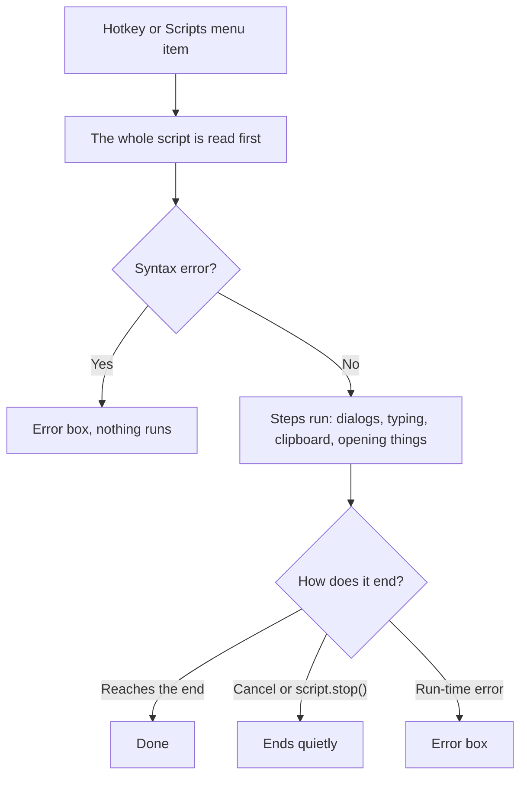

# Scripts

A **script** is a small text file that My Tools runs when you press its hotkey. It can ask you something, open a web page, start a program, use the clipboard, type text into the active window, and more.

Scripts are plain text files with the extension `.mts`, stored in `config\scripts` next to the exe.

```mts
query = dialog.ask("Search Google for:", clipboard.gettext())

if text.trim(query) != ""
    shell.open("https://www.google.com/search?q=" + text.urlencode(query))
end
```

**Warning.** Scripts can start programs, open any file or address, type keys into the active window, and read and replace the clipboard. There is no sandbox or permission check. Only run scripts you trust.

## Contents

This chapter has several pages:

- This page: [Getting started](#getting-started) and [the example script](#the-example-script-googlesearchmts).
- [Script Language](08a-script-language.md): values, variables, operators, `if` and lists.
- [Script Functions](08b-script-functions.md): everything a script can do, by module: dialogs, the clipboard, the keyboard, windows, programs and more.
- [Reusing Scripts and Examples](08c-script-examples.md): one script for several hotkeys, shared steps, and scripts to copy.
- [Script Errors and Limits](08d-script-errors.md): what the error messages mean, and what the language can't do.

## Getting started

### Where scripts live

Scripts are the `.mts` files in the `config\scripts` folder next to `CincoVertice.MyTools.Ui.Win.exe`. The first time My Tools starts, it creates the folder with an example, `GoogleSearch.mts`.

To edit them, use the tray menu: **Scripts > Edit scripts...**. The [config editor](07-config-editor.md) colors the script, underlines the first syntax error while you type, and can add new scripts with **New script...**. **Scripts > Open scripts folder** opens the folder, if you'd rather use another text editor.

### Running a script

- **From the tray menu:** **Scripts > *name***. Scripts are listed sorted by name.
- **With a hotkey:** open hotkeys.cfg from the tray menu (**Edit hotkeys...**), add a line with the script's name and a shortcut, and save the file:

  ```
  GoogleSearch = Ctrl+Alt+G
  ```

The script's name is its file name without `.mts`, keeping only ASCII letters, digits and `_`: `Google Search.mts` is `GoogleSearch`. A built-in action with the same name (such as `ShowCalculator`) keeps the hotkey. A file whose name starts with `_`, such as `_PrCommon.mts`, is a **library**, not a script you run: it is a piece other scripts include (see [Reusing scripts](08c-script-examples.md#reusing-scripts)), so it is not in the menu and can't get a hotkey.

A hotkey line can pass a value to the script after a comma, which the script reads with `script.argument()`. One script can then have several hotkeys, one line each:

```
PrTemplate = Ctrl+Alt+1, app1
PrTemplate = Ctrl+Alt+2, app2
```

A `#` after a space starts a comment, so `app#1` is passed whole, but `app #1` passes only `app`.

If a hotkeys.cfg line can't be used (a misspelled name, or a shortcut another program already uses), My Tools shows a notification when it loads the hotkeys, and the tray menu gets a **Hotkey problems** item that lists every problem.

### When changes apply

- **Editing a script:** applies the next time it runs, because the file is read each time.
- **Saving hotkeys.cfg, or adding, renaming or deleting a script file:** My Tools reloads the hotkeys and the **Scripts** menu half a second later, and shows "Hotkeys reloaded" (or the problems it found). If it ever misses a change, use **Reload hotkeys** in the tray menu.

No restart is needed for any of these.

A script runs once at a time: pressing its hotkey again while it runs (for example, while it asks you something) does nothing.

### What happens when a script runs



## The example script: GoogleSearch.mts

This script is created with the app. It asks what to search for (starting with the text on your clipboard), then opens Google in your default browser.

```mts
# My Tools script. Bind it in hotkeys.cfg, e.g. GoogleSearch = Ctrl+Alt+G; it applies when you save.
# The action's name is the file name; changes to this file apply the next time it runs.
#
# Functions, by module (see docs/user-guide/08b-script-functions.md for details):
#   dialog.ask(prompt, default)  dialog.form(title, [prompts], [defaults])  dialog.message(text)
#   dialog.confirm(question)  clipboard.gettext()  clipboard.settext(text)  keyboard.type(text)
#   clipboard.clear()  clipboard.pasteastext()  window.title()  window.tozone(number)
#   keyboard.press("Ctrl+V")  keyboard.press("Tab", 3)
#   shell.open(address or file)  shell.run(program, arguments)  tray.notify(text)
#   script.wait(ms)  script.stop()  system.waitidle(cpu %, disk %, quiet seconds, most minutes)
#   global.set(name, value)  global.get(name, default)  (kept between runs, in config\global.vars)
#   text.length  text.upper  text.lower  text.trim  text.replace(text, old, new)  text.contains(text, part)
#   text.urlencode  list.length(list)  list.contains(list, item)  number(value)  text(value)
# Lists:   [a, b, c]  list[1] is the first item  list + list
# Logic:   name = value   if ... elseif ... else ... end   == != < <= > >=   and or not   + - * / %
#
# To ask several things in one dialog:
#   answers = dialog.form("Search Google", ["Search for:", "Only on site:"], [clipboard.gettext(), ""])
#   query = answers[1]

query = dialog.ask("Search Google for:", clipboard.gettext())

if text.trim(query) != ""
    shell.open("https://www.google.com/search?q=" + text.urlencode(query))
end
```

How it works:

- `dialog.ask(...)` shows a dialog titled `My Tools: GoogleSearch` with the label "Search Google for:" and the clipboard text as the starting answer (empty if the clipboard has no text). **OK** stores the answer; **Cancel** ends the script quietly.
- `if text.trim(query) != ""` runs the next line only if the answer is not empty after trimming spaces.
- `shell.open(...)` opens the address in your default browser. `text.urlencode` makes the text safe for a web address, for example `a b&c` becomes `a%20b%26c`.

---

← Previous: [Config Editor](07-config-editor.md) | [Contents](README.md) | Next: [Script Language](08a-script-language.md) →
