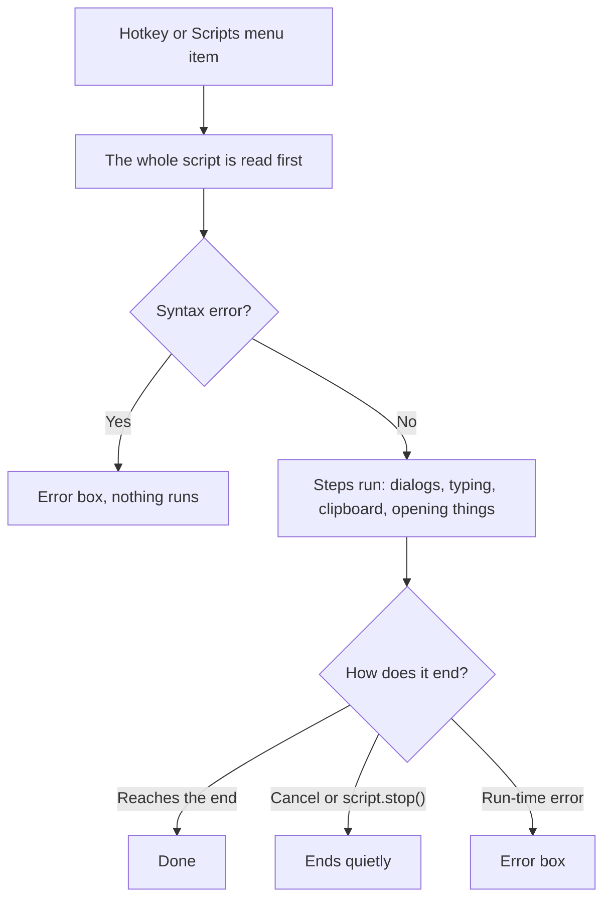

# Scripts

A **script** is a text file that automates a few steps: ask a question, type text, change the clipboard, open a web page, and so on. Scripts are plain text files with the extension `.mts`, stored in `config\scripts` next to the exe.

**Warning.** Scripts can start programs, open any file or address, type keys into the active window, and read and replace the clipboard. There is no sandbox or permission check. Only run scripts you trust.

## Getting started

1. Open the scripts folder with **Scripts > Open scripts folder**, or use **Edit scripts...** to edit the first script.
2. To make a new script, use **New script...** in the config editor.
3. To run it by hand, open **Scripts** in the tray menu and click its name.
4. To give it a hotkey, add a line to `hotkeys.cfg`, for example:

```
GoogleSearch = Ctrl+Alt+G
```

The action name is the file name without the extension, keeping only ASCII letters, digits and `_`. Scripts appear in the **Scripts** submenu sorted by name. If a script has the same name as a built-in action, the built-in wins.

A file whose name starts with `_` is a **library**. It is not an action and not in the menu; other scripts run it with `script.include`.

Adding, removing or renaming a script reloads the list of hotkeys on its own. Editing a script's text needs no reload, because the file is read each time the script runs. A second trigger of a script that is still running is ignored.

The diagram below shows what happens when a script runs.



## The example script: GoogleSearch.mts

This script is created with the app. It asks what to search for (starting with the text on your clipboard), then opens Google in your default browser.

```
# My Tools script. Bind it in hotkeys.cfg, e.g. GoogleSearch = Ctrl+Alt+G; it applies when you save.
# The action's name is the file name; changes to this file apply the next time it runs.
#
# Functions, by module (see SCRIPTING.md for details):
#   dialog.ask(prompt, default)  dialog.form(title, [prompts], [defaults])  dialog.message(text)
#   dialog.confirm(question)  clipboard.gettext()  clipboard.settext(text)  keyboard.type(text)
#   clipboard.clear()  clipboard.pasteastext()  window.title()
#   keyboard.press("Ctrl+V")  keyboard.press("Tab", 3)
#   shell.open(address or file)  shell.run(program, arguments)  tray.notify(text)
#   script.wait(ms)  script.stop()
#   global.set(name, value)  global.get(name, default)  (kept between runs, in config\global.vars)
#   text.length  text.upper  text.lower  text.trim  text.replace(text, old, new)  text.contains(text, part)
#   text.urlencode  list.length(list)  list.contains(list, item)  number(value)  text(value)
# Lists:   [a, b, c]  list[1] is the first item  list + list
# Logic:   name = value   if ... elseif ... else ... end   == != < <= > >=   and or not   + - * / %
#
# To ask several things in one dialog:
#   answers = dialog.form("Search Google", ["Search for:", "Only on site:"], [clipboard.gettext(), ""])
#   query = answers[1]

query = dialog.ask("Search Google for:", clipboard.gettext())

if text.trim(query) != ""
    shell.open("https://www.google.com/search?q=" + text.urlencode(query))
end
```

The comment says "see SCRIPTING.md". That file is not included with the app, so ignore the phrase; this guide covers the language.

How it works:

- `dialog.ask(...)` shows a dialog titled `My Tools: GoogleSearch` with the label "Search Google for:" and the clipboard text as the starting answer (empty if the clipboard has no text). **OK** stores the answer; **Cancel** ends the script quietly.
- `if text.trim(query) != ""` runs the next lines only if the answer is not empty after trimming spaces.
- `shell.open(...)` opens the address in your default browser. `text.urlencode` makes the text safe for a web address, for example `a b&c` becomes `a%20b%26c`.

## The language in brief

- **Comments:** `#` to the end of the line, also after code.
- **Statements:** one per line. A line break inside `( )` or `[ ]` does not end the statement.
- **Assign a value:** `name = expression`. A variable name cannot contain a dot.
- **Call a function** on its own line: `name(...)`. A function that returns a value may stand alone; the value is discarded.
- **Conditions:** `if cond` ... `elseif cond` ... `else` ... `end`. Indentation is free. A condition must be true or false.
- **Case:** names, functions and keywords are not case sensitive. The keywords are `if elseif else end and or not true false`.
- **Text:** in double quotes, with the escapes `\"`, `\\`, `\n` (new line) and `\t` (tab). For multi-line text, end a line with `"""`, write the lines, then start a line with `"""`. Escapes do not work there, and the indentation of the closing `"""` is removed from every line.
- **Numbers:** decimal numbers.
- **Lists:** `[a, b]`. `list[1]` is the first item. `+` joins two lists.
- **Operators:** `+ - * / %`, comparison `== != < <= > >=`, and `and or not`. `+` with a text on either side joins as text (`"Hi " + 2` is `Hi 2`). `==` is case-sensitive, and a text never equals a number. `<` and the like compare two numbers or two texts. Division by zero is an error.

## Function reference

Function names are written `module.function` and are not case sensitive (`clipboard.getText()` also works). Only `text(value)` and `number(value)` have no module. Functions marked "no value" return nothing, so you cannot store or use their result.

| Call | Returns | Notes |
|---|---|---|
| `dialog.ask(prompt[, default])` | text | OK / Cancel dialog; Cancel ends the script |
| `dialog.form(title, prompts[, defaults])` | list of texts | A form with several boxes; see below |
| `dialog.message(text)` | no value | Message box with an OK button |
| `dialog.confirm(question)` | true / false | Yes / No message box |
| `clipboard.gettext()` | text | Empty text when the clipboard has no text |
| `clipboard.settext(text)` | no value | Empty text clears the clipboard |
| `clipboard.clear()` | no value | Clears the clipboard |
| `clipboard.pasteastext()` | no value | Pastes the clipboard's text as plain text (sends Ctrl+V); does nothing if empty |
| `clipboard.paste(text)` | no value | Pastes the given text with Ctrl+V, then restores the clipboard after about 500 ms |
| `keyboard.type(text)` | no value | Types into the active window |
| `keyboard.press(keys[, times])` | no value | For example `keyboard.press("Ctrl+V")` or `keyboard.press("Tab", 3)`. Keys are written as in hotkeys.cfg, but a key alone is allowed. `times` is a whole number from 1 to 100. |
| `window.title()` | text | Title of the foreground window, empty if none |
| `shell.open(target)` | no value | Opens a web address, file or folder with its default program |
| `shell.run(program[, arguments])` | no value | Starts a program; does not wait for it |
| `tray.notify(text)` | no value | Balloon titled `My Tools: <Action>`, about 5 seconds |
| `script.wait(ms)` | no value | Waits 0 to 600000 milliseconds; the app stays responsive |
| `script.stop()` | no value | Ends the script quietly |
| `script.argument([default])` | text | The value after the shortcut in hotkeys.cfg; else the default; else empty text |
| `script.include(name)` | no value | Runs another script of the same folder with the caller's variables. `.mts` is optional. Up to 10 levels deep. |
| `global.set(name, value)` | no value | Saves a value in `config\global.vars` |
| `global.get(name[, default])` | value | An error if the name is missing and there is no default |
| `global.has(name)` | true / false | |
| `global.remove(name)` | no value | |
| `global.names()` | list of texts | Sorted ignoring case |
| `text.length(text)` | number | A list is refused; use `list.length` |
| `text.upper(text)`, `text.lower(text)`, `text.trim(text)` | text | |
| `text.replace(text, old, new)` | text | `old` must not be empty; case-sensitive |
| `text.contains(text, part)` | true / false | Ignores case |
| `text.urlencode(text)` | text | |
| `list.length(list)` | number | |
| `list.contains(list, item)` | true / false | Equality as `==` |
| `text(value)` | text | Number without trailing zeros, `true`/`false`, list as `[a, 1, true]` |
| `number(value)` | number | Accepts thousands commas such as "1,000" |

Functions that take text also accept a number or true/false and convert it.

**`dialog.form`.** The `title` is shown as bold text above the boxes. Each prompt becomes a label above a one-line text box. Buttons are **OK** (Enter) and **Cancel** (Esc); Cancel or closing the dialog ends the script quietly. The result is a list of the box texts in order, so use `answers[1]` for the first. A default that is a text or number is the starting text. A default that is a list makes a drop-down list with fixed items, the first selected; write `[[items], selected]` to select another one. Defaults may be fewer than the prompts but not more.

```
answers = dialog.form("Search Google", ["Search for:", "Only on site:"])
answers = dialog.form("New ticket", ["Ticket number:", "Type:"], ["", [["Bug", "Feature", "Task"], "Task"]])
```

**`keyboard.type`.** It first waits up to 3 seconds until Ctrl, Alt, Shift and Win are released, so that your hotkey does not turn the text into shortcuts; after 3 seconds it types anyway. Special characters are typed as themselves. A new line in the text becomes Enter and a tab becomes Tab. Typing blocks the app until it finishes. Typing into a program that runs as administrator may depend on Windows; My Tools does nothing special for it. For long text, `clipboard.paste(text)` is an alternative.

**`global.vars`.** `global.set` saves values in `config\global.vars` next to the exe, created the first time you use it. It is a text file in JSON form, for example after `global.set("a", 1)`:

```
{
  "a": 1
}
```

The file is read on every call, so hand edits apply immediately. If the file is not valid, scripts get the error `global.<fn>(): <path> is not valid: <reason>`.

## More sample scripts

**Ticket.mts** asks for a ticket number and a type, then types a template. The type is chosen from a drop-down.

```
# Ask for a ticket number and a type, then type a template.
answers = dialog.form("New ticket", ["Ticket number:", "Type:"], ["", [["Bug", "Feature", "Task"], "Task"]])
number = answers[1]
kind = answers[2]
if number == ""
    script.stop()
end
keyboard.type("[" + kind + " #" + number + "] Summary:" + "\n" + "Steps:\n\t1. ")
```

With number `7` and type `Task`, it types `[Task #7] Summary:`, Enter, `Steps:`, Enter, Tab, `1. `.

**QuoteClipboard.mts** wraps the clipboard text in quotes and shows how long the result is.

```
# Wrap the clipboard text in quotes, and show how long it is.
original = clipboard.gettext()
if text.length(original) == 0
    tray.notify("The clipboard has no text")
    script.stop()
end
wrapped = "\"" + text.trim(original) + "\""
clipboard.paste(wrapped)
tray.notify("Pasted " + text.length(wrapped) + " characters")
```

With `clip text` on the clipboard, it pastes `"clip text"` and shows the notification `Pasted 11 characters`.

**OpenSite.mts** opens a web site given by the hotkey's value and counts how many times it ran.

```
site = script.argument("example.com")
shell.open("https://" + site)
count = global.get("opened", 0) + 1
global.set("opened", count)
dialog.message("Opened " + site + " (" + count + " times so far)")
```

Bind it with two lines in `hotkeys.cfg`:

```
OpenSite = Ctrl+Alt+1, example.com
OpenSite = Ctrl+Alt+2, wikipedia.org
```

Pressing Ctrl+Alt+2 opens `https://wikipedia.org`. The first time the script runs from Ctrl+Alt+1, the message reads `Opened example.com (1 times so far)`. Run from the tray **Scripts** menu, or from a line without a value, the script uses its default, `example.com`.

## Script errors

Scripts are checked only when they run, or while you edit them in the config editor. Starting the app does not check them. The whole script is read before anything runs, so a syntax error stops it before any action.

An error appears as a message box with an error icon, titled `My Tools: <Action>`, with the text `<file>.mts, Line N, column M: <message>`, or `Could not read <path>: <reason>`.

**Cancelling.** There is no cancel command. A script can end itself with `script.stop()`, or you can press Cancel in a `dialog.ask` or `dialog.form`. Tray **Exit** ends the whole app.

Common syntax messages:

- `Unexpected character '<c>'`, with hints: `: use 'not' instead of '!'`, `: use 'and' instead of '&&'`, `: use 'or' instead of '||'`, `: texts use double quotes, "like this"`
- `The text is not closed: add a " at its end`
- `Unknown escape \<c>: use \" \\ \n or \t`
- `The number <n> is too large`
- `A variable name can't contain '.': '<name>' looks like a function`
- `A line must assign a value (name = ...) or call a function (name(...))`
- `'<kw>' without an 'if'`
- `Missing 'end' for the 'if' on line N`
- `Compare two values at a time: use 'and', as in a < b and b < c`
- `A list's items can't be changed: build a new list, e.g. names = [first, second]`
- `Use == to compare; = only assigns a value at the start of a line`
- `Missing ']'`, `Missing ')'`
- `Expected a value before the end of the line`, `Expected a value, not '<t>'`, `Expected the end of the line, not '<t>'`

Common run-time messages:

- `Unknown function '<f>'`, with the hint `: it is now <new>`, `: <module> has <functions>` or `: there is no module '<m>'`
- `<f>() takes <no arguments|1 argument|N arguments|A to B arguments>, not M`
- `Unknown variable '<v>'`, with the hint `: to call the function, write <v>()`
- `<f>() returns no value to store` or `... to use`
- `The condition must be true or false, not <type>`
- `There is no item N: the list has M items, and the first is 1`
- `Division by zero`
- `<function>(): <message>` for problems inside a function, for example:
  - `argument N must be a number, not <type>`
  - `the time must be from 0 to 600000 milliseconds`
  - `the text to replace can't be empty`
  - `there is no global variable '<name>'; global.get("<name>", value) gives a value then`
  - `'<name>' must be the name of a script in the scripts folder`
  - `There is no script <file> in <folder>`
  - `scripts include each other more than 10 levels deep: does <name> include itself?`

---

← Previous: [Config Editor](07-config-editor.md) | [Contents](README.md) | Next: [Code Review: Check and Fix a Folder](09-code-review.md) →
